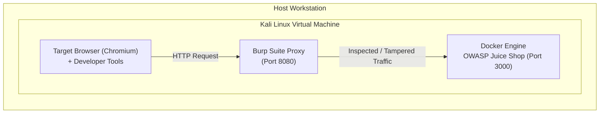
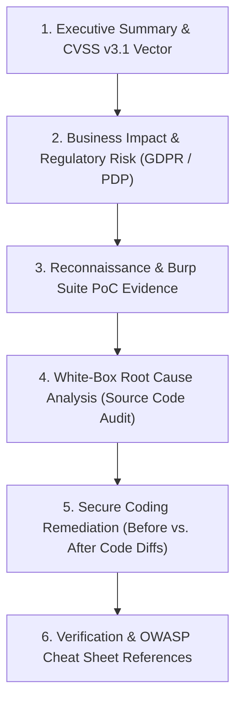

# 🛡️ OWASP Juice Shop: Complete Application Security (AppSec) Audit & Portfolio

[](https://hyphen-14.github.io/owasp-juice-shop-security-audit/)
[](https://hyphen-14.github.io/owasp-juice-shop-security-audit/progress/dashboard/)
[](https://hyphen-14.github.io/owasp-juice-shop-security-audit/progress/owasp-matrix/)
[](https://hyphen-14.github.io/owasp-juice-shop-security-audit/methodology/testing-framework/)
[](LICENSE)

> **An enterprise-grade web application penetration testing portfolio, vulnerability research catalog, and white-box source code audit covering all 100+ challenges in OWASP Juice Shop (Tiers 1★ through 6★).**

👉 **[Explore the Live Interactive Documentation Site](https://hyphen-14.github.io/owasp-juice-shop-security-audit/)**

---

## 🎯 Executive Summary

In today's cybersecurity landscape, identifying vulnerabilities is only half the job. Application Security (AppSec) Engineers and modern Penetration Testers must understand the **root cause in the application's source code** and communicate **production-ready remediations** to software engineering teams.

This repository serves as a showcase of:
- **Systematic Vulnerability Assessment:** Structured reconnaissance and testing following the **OWASP Web Security Testing Guide (WSTG v4.2)**.
- **Severity & Impact Evaluation:** Objective scoring via **CVSS v3.1** paired with realistic business risk analysis (data breach liability, regulatory compliance, financial impact).
- **White-Box Code Auditing:** Locating and dissecting defective logic inside the Node.js/Express backend, Angular client-side SPA, and SQLite/Sequelize database layers.
- **Secure Code Engineering:** Providing concrete *"Before vs. After"* code patches, schema validations, and defense-in-depth architectural hardening.

---

## 🏗️ Lab Architecture & Testing Environment

To ensure reproducible testing and isolation, all target components are containerized and analyzed through an interception proxy:



- **Target Lab:** `bkimminich/juice-shop` on Docker (Kali Linux VM).
- **Core Toolchain:** Burp Suite Professional/Community, Chrome DevTools, curl, Python 3.
- **Source Code Base:** Audited against upstream OWASP Juice Shop source code (TypeScript/Node.js/Angular).

---

## 📈 Challenge Roadmap & Completion Status

| Tier | Difficulty | Challenges | Status | Key Topics |
| :---: | :---: | :---: | :---: | :--- |
| **Tier 1** | ★☆☆☆☆☆ | 10 / 15 | ⏳ In Progress (66.7%) | SPA Recon, Client-side Validation, Error Leakage, DOM XSS |
| **Tier 2** | ★★☆☆☆☆ | 0 / 18 | ⏳ Planned | SQL Injection, Broken Authentication, IDOR, Password Security |
| **Tier 3** | ★★★☆☆☆ | 0 / 23 | ⏳ Planned | CSRF, XXE Data Exfiltration, Database Schema Enumeration |
| **Tier 4** | ★★★★☆☆ | 0 / 22 | ⏳ Planned | JWT Tampering, SSRF, NoSQL Injection, Access Escalation |
| **Tier 5** | ★★★★★☆ | 0 / 16 | ⏳ Planned | Insecure Deserialization, SSTI, Blind Injection |
| **Tier 6** | ★★★★★★ | 0 / 8 | ⏳ Planned | RCE, Complex Multi-step Exploit Chains, Race Conditions |
| **Total** | | **10 / 102** | **9.8% Completed** | Comprehensive OWASP Top 10 Coverage |

*Progress updates are tracked automatically via `python scripts/update_tracker.py`.*

---

## 📑 What Sets This Portfolio Apart?

Most CTF write-ups only explain *"what button was clicked"* or *"what payload was pasted"*. Every write-up in this repository follows our **[Industry-Standard AppSec Write-Up Template](docs/challenges/templates/writeup-template.md)**:



---

## 🚀 Running the Documentation Locally

This documentation is built using [MkDocs Material](https://squidfunk.github.io/mkdocs-material/). To run it locally:

1. **Clone the repository:**
   ```bash
   git clone https://github.com/Hyphen-14/owasp-juice-shop-security-audit.git
   cd owasp-juice-shop-security-audit
   ```

2. **Install Python dependencies:**
   ```bash
   pip install -r requirements.txt
   ```

3. **Launch the development server:**
   ```bash
   mkdocs serve
   ```
   Open `http://127.0.0.1:8000` in your web browser.

---

## 👤 Author & Connect

- **Author:** [Hyphen-14](https://github.com/Hyphen-14)
- **Specialization:** Application Security (AppSec) | Web Penetration Testing | Vulnerability Research
- **Live Site:** [https://hyphen-14.github.io/owasp-juice-shop-security-audit/](https://hyphen-14.github.io/owasp-juice-shop-security-audit/)

---

## ⚖️ Disclaimer & Ethical Conduct
All assessments and code analysis documented herein were performed strictly on an isolated, local instance of OWASP Juice Shop solely for defensive learning, education, and security research purposes in compliance with ethical guidelines.

