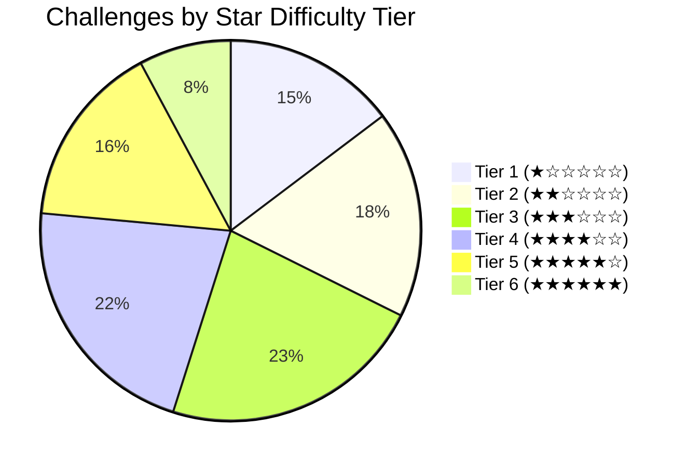

# Challenge Catalog & Taxonomy

OWASP Juice Shop contains over 100 intentional security flaws designed to simulate modern web application vulnerabilities. 

---

## 🗂️ Tier Breakdown

### Difficulty Overview:
1. [**Tier 1 (1-Star Basics)**](tier-1/index.md): Fundamental web security, reconnaissance, client-side source map exploration, and basic error handling.
2. [**Tier 2 (2-Star Intermediate)**](tier-2/index.md): Basic SQL injection, direct object references, password cracking, and deprecated interfaces.
3. [**Tier 3 (3-Star Advanced)**](tier-3/index.md): CSRF, XXE injection, crypto flaws, and database bypasses.
4. [**Tier 4 (4-Star Complex)**](tier-4/index.md): JWT manipulation, NoSQL injection, SSRF, and access escalation.
5. [**Tier 5 (5-Star Hard)**](tier-5/index.md): Insecure deserialization, template injection (SSTI), and blind SQLi.
6. [**Tier 6 (6-Star Expert)**](tier-6/index.md): Complex vulnerability chains, remote code execution (RCE), and race conditions.

---

## 📝 Reporting Standard & Guidelines
Every challenge write-up adheres to our [AppSec Write-up Template](templates/writeup-template.md), ensuring consistency across CVSS scores, business impacts, code audits, and remediation snippets.

