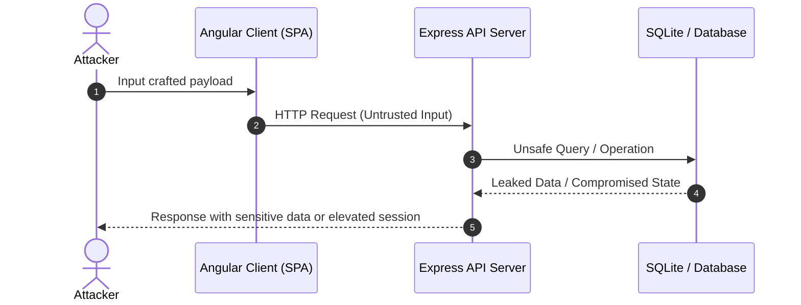

# [Vulnerability Name / Challenge Title]

| Field | Details |
| :--- | :--- |
| **Challenge ID** | `CH-XXX` |
| **Difficulty Tier** | ★☆☆☆☆☆ (1-Star) |
| **Category** | e.g. Injection / Broken Access Control / XSS |
| **OWASP Top 10 (2021)**| e.g. A03:2021 - Injection |
| **CWE ID** | [CWE-89: SQL Injection](https://cwe.mitre.org/data/definitions/89.html) |
| **CVSS v3.1 Base Score**| **7.5 (High)** — `CVSS:3.1/AV:N/AC:L/PR:N/UI:N/S:U/C:H/I:N/A:N` |
| **Target Technology** | Node.js / Express / Angular / SQLite |

---

## 1. Executive Summary & Business Impact

### 1.1 Executive Overview
*Provide a high-level, business-friendly summary explaining what the vulnerability is in plain terms, why it occurred, and how severe it is.*

### 1.2 Business Impact Analysis
- **Confidentiality:** Unauthorized disclosure of sensitive customer data (PII, credentials, order history).
- **Integrity:** Potential tampering with business records, catalog pricing, or database tables.
- **Availability:** Service disruption or denial-of-service risks.
- **Compliance & Legal Risk:** Violations of regulations such as GDPR / Indonesia PDP Law (UU Pelindungan Data Pribadi) and PCI-DSS requirements.

---

## 2. Reconnaissance & Discovery Methodology

### 2.1 Inspection & Recon Workflow
*Detail the reconnaissance phase using standard tools (Browser DevTools, Burp Suite, curl).*
1. Endpoint mapping and network traffic observation.
2. Source code and client-side bundle inspection (`main.js`, source maps, or inline scripts).
3. Identification of untrusted input vectors or unauthenticated endpoints.

### 2.2 Attack Surface Map


---

## 3. Proof of Concept (PoC) & Exploitation

> [!NOTE]
> All testing was conducted ethically in a controlled local laboratory environment for educational and defense-readiness purposes.

### 3.1 Step-by-Step Reproduction
1. Navigate to `http://<target-ip>:3000/#/<endpoint>`.
2. Intercept the request via Burp Suite Proxy.
3. Observe the vulnerable parameter:
   ```http
   POST /api/vulnerable-endpoint HTTP/1.1
   Host: target:3000
   Content-Type: application/json

   {
     "param": "payload_here"
   }
   ```
4. Send the crafted payload and observe the response:
   ```http
   HTTP/1.1 200 OK
   Content-Type: application/json
   
   {
     "status": "success",
     "data": [...]
   }
   ```

### 3.2 Visual Evidence (Proof of Concept)
*Attach screenshots showing Burp Suite request/response, browser behavior, or challenge solve notification.*

```markdown

*Figure 1: Request manipulation and server response demonstrating the vulnerability.*


*Figure 2: OWASP Juice Shop notification confirming vulnerability verification.*
```

---

## 4. White-Box Root Cause Analysis

### 4.1 Vulnerable Source Code
- **Repository File:** `routes/<vulnerable-file>.ts` (or `frontend/src/...`)
- **Vulnerable Lines:** Lines `XX` - `YY`

```typescript
// VULNERABLE CODE PATTERN
models.sequelize.query(`SELECT * FROM Users WHERE email = '${req.body.email}' AND password = '${security.hash(req.body.password)}'`)
  .then(([user]) => {
    // Unsafe handling
  });
```

### 4.2 Root Cause Breakdown
*Explain why the code failed:*
- **Mechanism:** Direct string concatenation of untrusted client input (`req.body.email`) into the database query without parameterized binding or input sanitization.
- **Architectural Flaw:** Lack of a centralized Data Access Object (DAO) enforcing Object-Relational Mapping (ORM) parameterized calls.

---

## 5. Remediation & Secure Coding Guidance

### 5.1 Code Comparison (Before vs. After)

=== "❌ Vulnerable (Current Implementation)"
    ```typescript
    // Direct string interpolation allows payload breakout
    const query = `SELECT * FROM Products WHERE id = ${req.params.id}`;
    await sequelize.query(query);
    ```

=== "✅ Secure (Patched Implementation)"
    ```typescript
    // Parameterized query using Sequelize replacements
    const query = 'SELECT * FROM Products WHERE id = :id';
    await sequelize.query(query, {
      replacements: { id: req.params.id },
      type: QueryTypes.SELECT
    });
    ```

### 5.2 Defense-in-Depth Measures
1. **Input Validation:** Enforce strict type validation and whitelisting at the API boundary using schema validators (e.g. `Joi`, `zod`).
2. **Least Privilege:** Ensure database connection accounts run with minimum required permissions (no administrative or DDL rights).
3. **WAF & Rate Limiting:** Implement edge protections to mitigate brute-force attempts and anomalous payload signatures.

---

## 6. Verification & References

### 6.1 Retesting Procedure
1. Apply the recommended patch to the local codebase.
2. Re-run the reproduction payload using Burp Suite Repeater.
3. Verify that the server returns `400 Bad Request` or safely escaped results without executing the payload.

### 6.2 Industry Standards & References
- **OWASP Cheat Sheet:** [OWASP SQL Injection Prevention Cheat Sheet](https://cheatsheetseries.owasp.org/)
- **CWE Advisory:** [CWE-89: Improper Neutralization of Special Elements used in an SQL Command](https://cwe.mitre.org/data/definitions/89.html)
- **CVSS Calculator:** [NVD CVSS v3.1 Calculator](https://nvd.nist.gov/vuln-metrics/cvss/v3-calculator)

