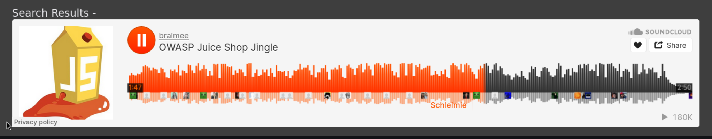
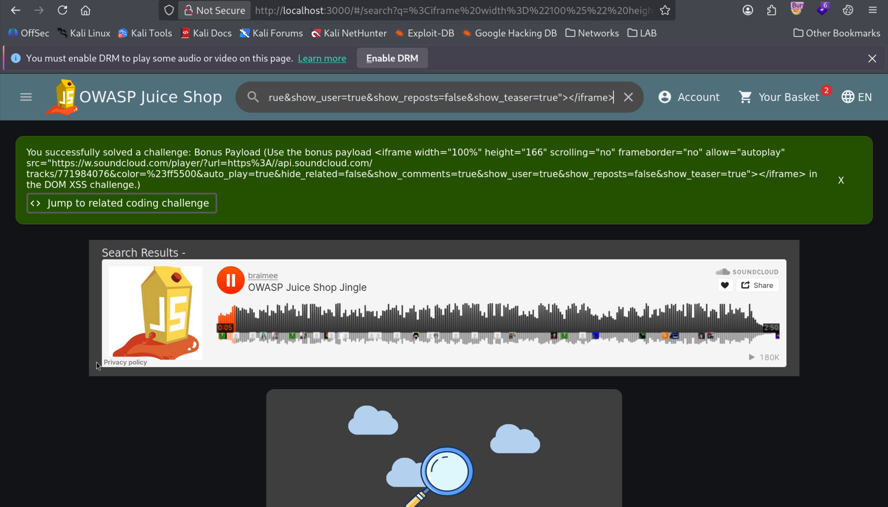

# Bonus Payload (Third-Party Media DOM Injection)

| Field | Details |
| :--- | :--- |
| **Challenge ID** | `CH-T1-05` |
| **Difficulty Tier** | ★☆☆☆☆☆ (1-Star) |
| **Category** | Cross-Site Scripting (XSS) / Content Spoofing |
| **OWASP Top 10 (2021)**| A03:2021 - Injection |
| **CWE ID** | [CWE-79: Cross-Site Scripting (XSS)](https://cwe.mitre.org/data/definitions/79.html) |
| **CVSS v3.1 Base Score**| **4.3 (Medium)** — `CVSS:3.1/AV:N/AC:L/PR:N/UI:R/S:U/C:N/I:L/A:N` |
| **Target Technology** | Angular / Unrestricted Frame Embedding |

---

## 1. Executive Summary & Business Impact

### 1.1 Executive Overview
Beyond executing basic alert popups, Cross-Site Scripting vulnerabilities allow attackers to embed external third-party media, widgets, and dynamic interactive frames into the victim's session. 

In this challenge, testing the search input DOM sink with an external media player iframe (SoundCloud widget with autoplay parameters) demonstrated that the application accepts arbitrary third-party content inclusion, exposing users to content spoofing, unsolicited audio/media playback, and tracking risks.

### 1.2 Business Impact Analysis
- **Content Spoofing & Brand Damage:** Malicious actors can embed offensive audio, video, or deceptive interfaces directly inside the official corporate domain.
- **Third-Party Tracking & Privacy Violations:** Unauthorized iframes can set third-party tracking cookies or fingerprint visitors without consent under GDPR / ePrivacy directives.
- **Clickjacking Precursor:** Demonstrates lack of `frame-src` restrictions in the security posture.

---

## 2. Reconnaissance & Discovery Methodology

### 2.1 Inspection Workflow
1. Re-audited the unescaped search DOM sink identified in the DOM XSS assessment.
2. Constructed a complex HTML injection payload embedding an external SoundCloud streaming player iframe:
   ```html
   <iframe width="100%" height="166" scrolling="no" frameborder="no" allow="autoplay" src="https://w.soundcloud.com/player/?url=https%3A//api.soundcloud.com/tracks/771984076&color=%23ff5500&auto_play=true&hide_related=false&show_comments=true&show_user=true&show_reposts=false&show_teaser=true"></iframe>
   ```
3. Submitted the payload into the client search input.

---

## 3. Proof of Concept (PoC) & Exploitation

### 3.1 Step-by-Step Reproduction
1. Open the search toolbar in OWASP Juice Shop (`http://localhost:3000`).
2. Paste the SoundCloud iframe injection payload and execute search.
3. The DOM sink renders the iframe element, initiating the external player stream within the page DOM.


*Figure 1: External audio stream widget successfully injected and rendered in the application UI.*

4. The platform registers verification of the bonus payload injection.


*Figure 2: Toast notification confirming completion of the Bonus Payload challenge.*

---

## 4. White-Box Root Cause Analysis

### 4.1 Vulnerable Source Code
- **Repository Location:** `frontend/src/app/search-result/search-result.component.ts`
- **Root Cause Mechanism:** The component passes raw search query inputs to `bypassSecurityTrustHtml()`, bypassing Angular's sanitization for both `<script>` tags and embedded `<iframe>` elements.

---

## 5. Remediation & Secure Coding Guidance

### 5.1 Content Security Policy (CSP) Frame Restrictions
To completely eliminate unauthorized external frame embedding regardless of DOM tampering:

```http
Content-Security-Policy: default-src 'self'; frame-src 'none'; object-src 'none';
```

If specific media providers are legitimately required, restrict to strict domain whitelists:
```http
Content-Security-Policy: frame-src 'self' https://w.soundcloud.com;
```

---

## 6. Verification & References
- **OWASP Top 10:2021:** [A03:2021 - Injection](https://owasp.org/Top10/A03_2021-Injection/)
- **CWE Definition:** [CWE-79: Cross-Site Scripting](https://cwe.mitre.org/data/definitions/79.html)
- **MDN Web Docs:** [Content Security Policy: frame-src](https://developer.mozilla.org/en-US/docs/Web/HTTP/Headers/Content-Security-Policy/frame-src)
