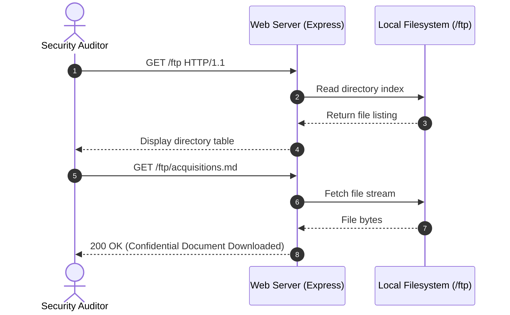
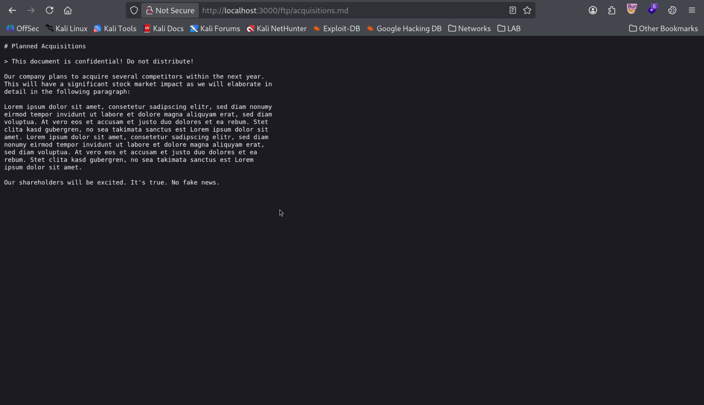
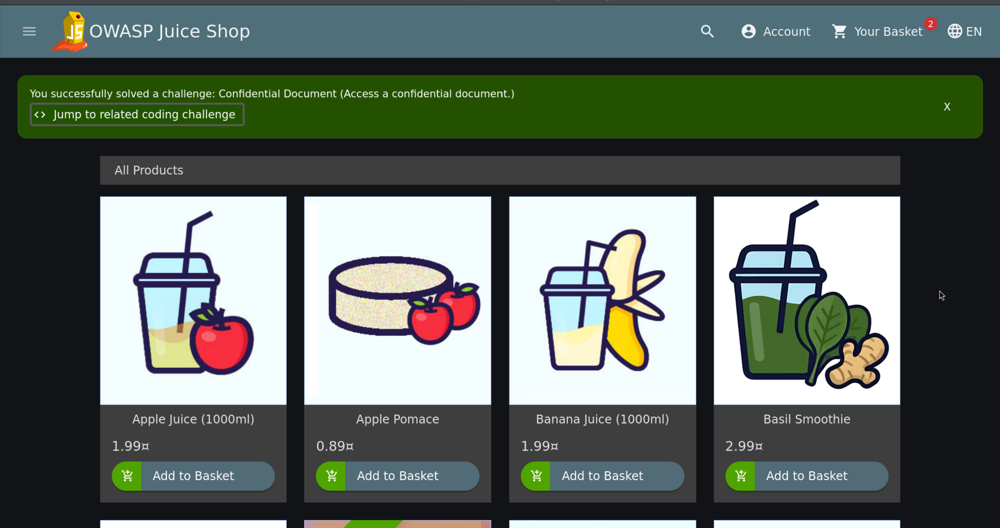

# Confidential Document Exposure

| Field | Details |
| :--- | :--- |
| **Challenge ID** | `CH-T1-03` |
| **Difficulty Tier** | ★☆☆☆☆☆ (1-Star) |
| **Category** | Broken Access Control / Sensitive Data Exposure |
| **OWASP Top 10 (2021)**| A01:2021 - Broken Access Control |
| **CWE ID** | [CWE-552: Files or Directories Accessible to External Parties](https://cwe.mitre.org/data/definitions/552.html) |
| **CVSS v3.1 Base Score**| **5.3 (Medium)** — `CVSS:3.1/AV:N/AC:L/PR:N/UI:N/S:U/C:L/I:N/A:N` |
| **Target Technology** | Express.js Static File Serving (`serve-index`) |

---

## 1. Executive Summary & Business Impact

### 1.1 Executive Overview
Web servers frequently store non-public operational assets, backups, or legacy files within storage directories. When public directory listing is enabled or file storage endpoints lack access control checks, external parties can browse directory structures and download proprietary business data.

In this assessment, the `/ftp` endpoint exposed a publicly accessible directory listing containing corporate documentation. An unauthenticated auditor was able to discover and download `acquisitions.md`, a confidential internal document outlining corporate mergers and acquisitions.

### 1.2 Business Impact Analysis
- **Confidentiality:** Direct disclosure of material non-public financial intelligence (mergers, intellectual property, corporate strategy).
- **Market & Legal Liability:** Premature disclosure of acquisitions can trigger regulatory investigations (SEC / insider trading regulations) and breach confidentiality agreements (NDAs).
- **Reputational Harm:** Loss of competitive advantage and erosion of partner trust.

---

## 2. Reconnaissance & Discovery Methodology

### 2.1 Inspection Workflow
1. Performed directory enumeration on common static asset and legacy upload paths (`/files`, `/uploads`, `/ftp`, `/public`).
2. Navigated to `http://localhost:3000/ftp` in the browser.
3. Observed that the server utilizes the `serve-index` middleware, rendering an HTML index of files residing in the target folder.
4. Identified sensitive files including `acquisitions.md`, `eastere.gg`, `legal.md`, and `package.json.bak`.

### 2.2 Attack Surface Sequence


---

## 3. Proof of Concept (PoC) & Exploitation

> [!NOTE]
> Testing executed ethically in an isolated local container.

### 3.1 Step-by-Step Reproduction
1. Open the web browser and browse to:
   ```text
   http://localhost:3000/ftp
   ```
2. Inspect the rendered file list.


*Figure 1: Publicly accessible directory indexing at `/ftp` exposing confidential documentation.*

3. Click on the hyperlink for `acquisitions.md` (or download directly via `curl`):
   ```bash
   curl -O http://localhost:3000/ftp/acquisitions.md
   ```
4. The file contents are retrieved in plaintext, and the application triggers challenge resolution.


*Figure 2: Toast notification confirming successful challenge verification.*

---

## 4. White-Box Root Cause Analysis

### 4.1 Vulnerable Source Code
- **Repository Location:** `server.ts`
- **Vulnerable Code Pattern:**

```typescript
// INSECURE STATIC ASSET EXPOSURE
import serveIndex from 'serve-index';

// ⚠️ Flaw 1: Public directory indexing enabled on sensitive directory
app.use('/ftp', serveIndex('ftp', { icons: true }))

// ⚠️ Flaw 2: Static file delivery without authentication checks
app.use('/ftp', express.static('ftp'))
```

### 4.2 Root Cause Breakdown
- **Insecure Default Middleware:** Applying `serve-index` directly on an unauthenticated path exposes the entire directory inventory to untrusted visitors.
- **Absence of Least Privilege Isolation:** Storing internal documentation inside the web root public directory instead of an isolated, encrypted document store.

---

## 5. Remediation & Secure Coding Guidance

### 5.1 Code Comparison (Before vs. After)

=== "❌ Vulnerable (Public Directory Indexing)"
    ```typescript
    // server.ts
    app.use('/ftp', serveIndex('ftp', { icons: true }));
    app.use('/ftp', express.static('ftp'));
    ```

=== "✅ Secure (Authenticated Controlled File Access)"
    ```typescript
    // server.ts - Remove public directory listing
    // Documents are served through an authenticated controller enforcing access control
    app.get('/api/documents/:filename', authenticateUser, (req: Request, res: Response) => {
      const allowedRoles = ['EXECUTIVE', 'LEGAL_ADMIN'];
      if (!allowedRoles.includes(req.user.role)) {
        return res.status(403).json({ error: "Access Denied: Insufficient Permissions" });
      }

      // Prevent Path Traversal (CWE-22)
      const safeFilename = path.basename(req.params.filename);
      const filePath = path.resolve(__dirname, '../secure-storage', safeFilename);

      res.sendFile(filePath);
    });
    ```

### 5.2 Defense-in-Depth Measures
1. **Disable Directory Browsing:** Ensure directory indexing modules are completely disabled in production web servers (e.g., Nginx `autoindex off;` or Apache `Options -Indexes`).
2. **Dedicated Cloud Storage:** Store sensitive enterprise documents outside the web application container in an S3-compatible private bucket governed by IAM policies.

---

## 6. Verification & References

### 6.1 Retesting Procedure
1. Re-request `http://localhost:3000/ftp`.
2. Confirm the server returns `404 Not Found` or `403 Forbidden`.
3. Verify that direct file paths (`/ftp/acquisitions.md`) cannot be retrieved without an authorized session.

### 6.2 Industry Standards & References
- **OWASP Top 10:2021:** [A01:2021 - Broken Access Control](https://owasp.org/Top10/A01_2021-Broken_Access_Control/)
- **CWE Definition:** [CWE-552: Files or Directories Accessible to External Parties](https://cwe.mitre.org/data/definitions/552.html)
- **OWASP Cheat Sheet:** [File Storage and Access Control](https://cheatsheetseries.owasp.org/)

