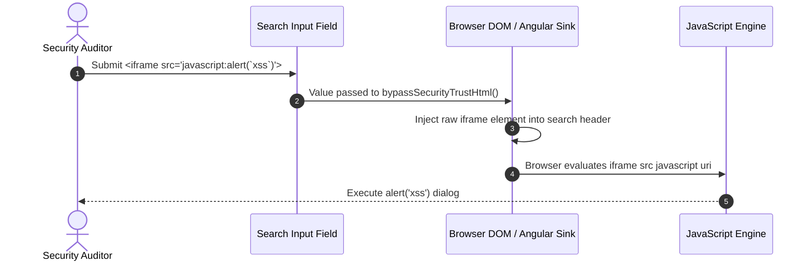
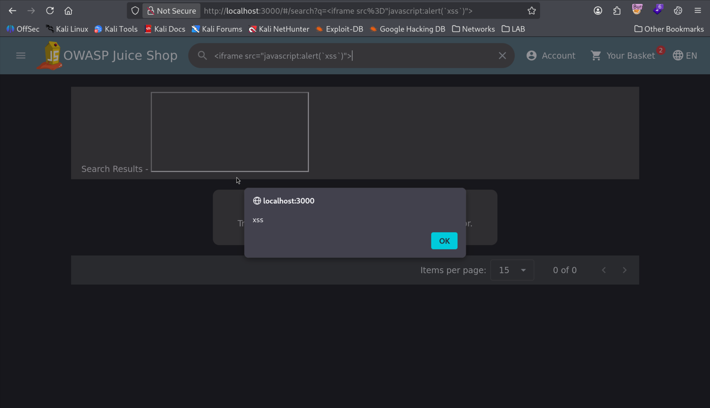
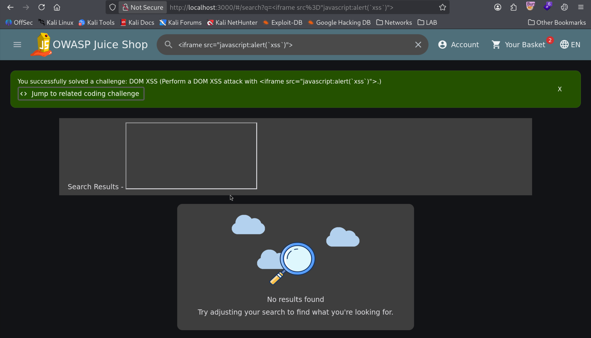

# DOM-Based Cross-Site Scripting (DOM XSS)

| Field | Details |
| :--- | :--- |
| **Challenge ID** | `CH-T1-04` |
| **Difficulty Tier** | ★☆☆☆☆☆ (1-Star) |
| **Category** | Cross-Site Scripting (XSS) / Injection |
| **OWASP Top 10 (2021)**| A03:2021 - Injection |
| **CWE ID** | [CWE-79: Cross-Site Scripting (XSS)](https://cwe.mitre.org/data/definitions/79.html) |
| **CVSS v3.1 Base Score**| **6.1 (Medium)** — `CVSS:3.1/AV:N/AC:L/PR:N/UI:R/S:C/C:L/I:L/A:N` |
| **Target Technology** | Angular / Client-Side DOM Sink |

---

## 1. Executive Summary & Business Impact

### 1.1 Executive Overview
Cross-Site Scripting (XSS) occurs when untrusted user input is incorporated into an active web page without sufficient validation or output encoding. In a **DOM-based XSS**, the vulnerability resides purely on the client side: user-controlled data (the *source*) flows into an execution context in the browser DOM (the *sink*) without ever passing through or being sanitized by the backend server.

In this assessment, the product search field accepted HTML/JavaScript payloads and directly injected them into the Document Object Model using an `iframe` element, executing arbitrary JavaScript in the victim's session context.

### 1.2 Business Impact Analysis
- **Session Hijacking:** Attackers can extract authentication tokens (JWT in `localStorage`), session cookies, and sensitive user state.
- **Client-Side Account Takeover:** Injected scripts can perform actions on behalf of the victim (placing unauthorized orders, changing passwords).
- **Phishing & Defacement:** Injected iframes can overlay realistic credential harvest prompts over trusted application UI.

---

## 2. Reconnaissance & Discovery Methodology

### 2.1 Inspection Workflow
1. Inspected the client-side search component in Angular (`search-result.component.ts`).
2. Observed how the URL query parameter (`?q=...`) was reflected in the page UI:
   ```text
   http://localhost:3000/#/search?q=<test>
   ```
3. Reviewed the component template and discovered the search string was rendered using Angular's `bypassSecurityTrustHtml` mechanism, explicitly disabling built-in Angular sanitization.

### 2.2 Attack Surface Sequence


---

## 3. Proof of Concept (PoC) & Exploitation

> [!NOTE]
> Testing executed on an isolated container target.

### 3.1 Step-by-Step Reproduction
1. Navigate to the main storefront at `http://localhost:3000`.
2. Click the **Search** icon (magnifying glass) in the top-right toolbar.
3. Input the standard iframe XSS vector:
   ```html
   <iframe src="javascript:alert(`xss`)">
   ```
4. Press **Enter**.
5. The browser evaluates the DOM injection, executing the script and displaying the JavaScript `alert('xss')` dialog.


*Figure 1: Successful execution of client-side JavaScript via DOM-based XSS.*

6. Dismissing the dialog reveals the challenge completion notification.


*Figure 2: OWASP Juice Shop confirmation notification for the DOM XSS challenge.*

---

## 4. White-Box Root Cause Analysis

### 4.1 Vulnerable Source Code
- **Repository Location:** `frontend/src/app/search-result/search-result.component.ts`
- **Vulnerable Code Pattern:**

```typescript
// INSECURE DOM SANITIZATION BYPASS
import { DomSanitizer } from '@angular/platform-browser';

export class SearchResultComponent {
  constructor(private sanitizer: DomSanitizer) {}

  filterTable () {
    const query = this.route.snapshot.queryParams.q;
    // ⚠️ Flaw: Explicitly instructing Angular to bypass built-in HTML encoding
    this.searchValue = this.sanitizer.bypassSecurityTrustHtml(query);
  }
}
```

### 4.2 Root Cause Breakdown
- **Misuse of Security Bypass APIs:** Angular by default sanitizes and escapes all interpolation expressions (`{{ ... }}`). The developer deliberately neutralized this protection by invoking `DomSanitizer.bypassSecurityTrustHtml()` on unsanitized user query parameters.

---

## 5. Remediation & Secure Coding Guidance

### 5.1 Code Comparison (Before vs. After)

=== "❌ Vulnerable (Bypassing Sanitization)"
    ```typescript
    // search-result.component.ts
    this.searchValue = this.sanitizer.bypassSecurityTrustHtml(this.query);
    ```
    ```html
    <!-- search-result.component.html -->
    <span [innerHTML]="searchValue"></span>
    ```

=== "✅ Secure (Contextual Interpolation & DOMPurify)"
    ```html
    <!-- search-result.component.html -->
    <!-- Native Angular interpolation strictly treats input as plain text -->
    <span>Search results for: {{ searchValue }}</span>
    ```
    ```typescript
    // Alternatively, if rich HTML formatting is required, sanitize with DOMPurify:
    import DOMPurify from 'dompurify';

    this.searchValue = DOMPurify.sanitize(this.query);
    ```

### 5.2 Defense-in-Depth Measures
1. **Content Security Policy (CSP):** Deploy strict HTTP response headers disabling inline script evaluation and frame embedding:
   ```http
   Content-Security-Policy: default-src 'self'; script-src 'self'; object-src 'none'; frame-src 'none';
   ```
2. **Static Analysis Rule (SAST):** Configure ESLint rules (`@angular-eslint/no-bypass-security-trust`) in the CI/CD pipeline to block pull requests utilizing `bypassSecurityTrust*` methods without security team sign-off.

---

## 6. Verification & References

### 6.1 Retesting Procedure
1. Replace `bypassSecurityTrustHtml` with native text binding.
2. Resubmit the payload `<iframe src="javascript:alert(`xss`)">` in the search box.
3. Confirm that the input is rendered as literal text (`&lt;iframe...&gt;`) without script execution or dialog popups.

### 6.2 Industry Standards & References
- **OWASP Top 10:2021:** [A03:2021 - Injection](https://owasp.org/Top10/A03_2021-Injection/)
- **CWE Definition:** [CWE-79: Improper Neutralization of Input During Web Page Generation](https://cwe.mitre.org/data/definitions/79.html)
- **OWASP Cheat Sheet:** [DOM-based XSS Prevention Cheat Sheet](https://cheatsheetseries.owasp.org/cheatsheets/DOM_based_XSS_Prevention_Cheat_Sheet.html)
