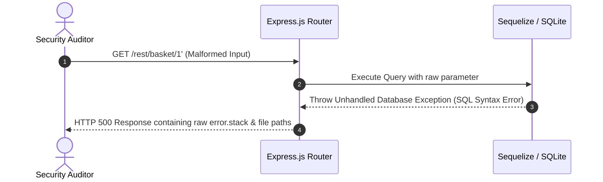
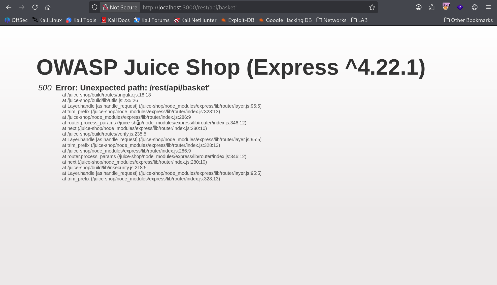
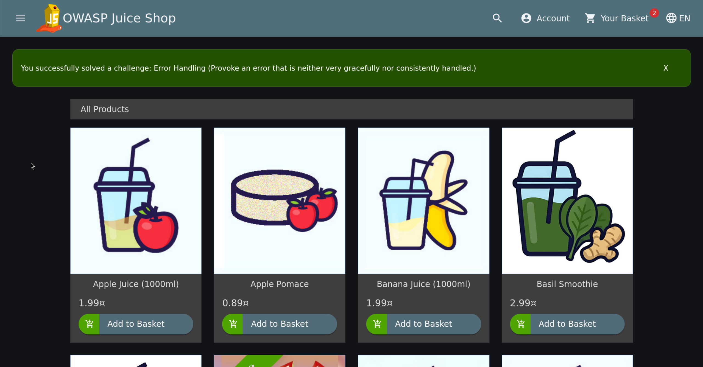

# Error Handling Leak (Unhandled Exception)

| Field | Details |
| :--- | :--- |
| **Challenge ID** | `CH-T1-02` |
| **Difficulty Tier** | ★☆☆☆☆☆ (1-Star) |
| **Category** | Security Misconfiguration / Information Disclosure |
| **OWASP Top 10 (2021)**| A05:2021 - Security Misconfiguration |
| **CWE ID** | [CWE-209: Generation of Error Message Containing Sensitive Information](https://cwe.mitre.org/data/definitions/209.html) |
| **CVSS v3.1 Base Score**| **5.3 (Medium)** — `CVSS:3.1/AV:N/AC:L/PR:N/UI:N/S:U/C:L/I:N/A:N` |
| **Target Technology** | Express.js / Node.js / Sequelize ORM / SQLite |

---

## 1. Executive Summary & Business Impact

### 1.1 Executive Overview
During standard web interaction, unexpected user inputs or malformed parameters can trigger edge-case exceptions within application logic. When an application lacks centralized error handling or runs in a debug configuration, the server may serialize raw internal error objects and stack traces directly into HTTP responses.

In this assessment, supplying an unhandled data type to a REST endpoint provoked an internal database exception. The application reflected a detailed Sequelize error stack trace revealing internal filesystem layouts, database technology versions, and raw SQL queries.

### 1.2 Business Impact Analysis
- **Confidentiality:** Exposure of internal server paths, runtime environments, package versions, and database schemas.
- **Attack Surface Expansion:** Attackers utilize leaked stack traces to blueprint exact backend software versions and identify known CVEs or SQL injection vectors.
- **Compliance Deficiencies:** Exposing internal system errors violates secure baseline requirements under standards such as PCI-DSS (Requirement 6.5.5) and OWASP ASVS v4.0.

---

## 2. Reconnaissance & Discovery Methodology

### 2.1 Inspection Workflow
1. Intercepted and mapped REST API endpoints communicating between the Angular client and Express backend.
2. Targeted the basket and product lookup endpoints which accept entity identifiers (e.g., `/rest/basket/{id}`).
3. Injected boundary characters (single quote `'`, non-numeric characters, or special syntax) into numerical parameter slots:
   ```http
   GET /rest/basket/1' HTTP/1.1
   Host: localhost:3000
   ```
4. Observed that the application returned an unhandled HTTP 500 Internal Server Error containing complete internal stack traces.

### 2.2 Attack Surface Sequence


---

## 3. Proof of Concept (PoC) & Exploitation

> [!NOTE]
> Testing conducted on a local containerized target for defensive verification.

### 3.1 Step-by-Step Reproduction
1. Access the target application endpoint via browser or curl:
   ```bash
   curl -i -s "http://localhost:3000/rest/basket/1'"
   ```
2. Inspect the response body. The server returns a JSON error structure containing the SQLite dialect error and Node.js call stack.


*Figure 1: Malformed input causing unhandled Sequelize error stack trace leakage.*

3. The application acknowledges resolution of the security challenge upon triggering the unhandled exception.


*Figure 2: OWASP Juice Shop confirmation notification for the Error Handling challenge.*

---

## 4. White-Box Root Cause Analysis

### 4.1 Vulnerable Source Code
- **Repository Location:** `routes/basket.ts` / Centralized error middleware
- **Vulnerable Code Pattern:**

```typescript
// VULNERABLE ROUTE HANDLER
export function basket () {
  return (req: Request, res: Response, next: NextFunction) => {
    const id = req.params.id
    BasketModel.findOne({ where: { id } })
      .then((basket: Basket | null) => {
        res.json(utils.queryResultToJson(basket))
      })
      .catch((error: Error) => {
        // ⚠️ Flaw: Passing raw error object directly to client response
        res.status(500).send(error)
      })
  }
}
```

### 4.2 Root Cause Breakdown
- **Direct Error Serialization:** In catch blocks, internal error objects (`error` or `error.stack`) are piped directly to `res.send()`.
- **Missing Environment Guard:** The application lacks a production environment toggle (`NODE_ENV === 'production'`) to suppress verbose stack traces.

---

## 5. Remediation & Secure Coding Guidance

### 5.1 Code Comparison (Before vs. After)

=== "❌ Vulnerable (Direct Stack Trace Return)"
    ```typescript
    app.use((err: Error, req: Request, res: Response, next: NextFunction) => {
      // Exposes technical details to unauthenticated visitors
      res.status(500).json({
        message: err.message,
        stack: err.stack
      });
    });
    ```

=== "✅ Secure (Generic Error with Unique Correlation ID)"
    ```typescript
    import { v4 as uuidv4 } from 'uuid';
    import logger from './lib/logger';

    app.use((err: Error, req: Request, res: Response, next: NextFunction) => {
      const incidentId = uuidv4();
      
      // Log technical details internally for engineering teams
      logger.error(`[Incident ${incidentId}] Error processing ${req.method} ${req.url}:`, err);

      // Return sanitized, generic response to user
      res.status(500).json({
        error: "An unexpected internal server error occurred.",
        referenceId: incidentId
      });
    });
    ```

### 5.2 Defense-in-Depth Measures
1. **Global Error Middleware:** Register a catch-all Express error-handling middleware (`(err, req, res, next)`) as the final handler in the pipeline.
2. **Input Validation:** Enforce strict type constraints (e.g. validating that `:id` is strictly an integer) using validators such as `express-validator` or `zod` prior to database queries.

---

## 6. Verification & References

### 6.1 Retesting Procedure
1. Send a malformed payload to the endpoint (`/rest/basket/invalid'`).
2. Verify that the response returns a generic message (`An unexpected error occurred`) and HTTP 400/500 without `stack` or internal path strings.

### 6.2 Industry Standards & References
- **OWASP Top 10:2021:** [A05:2021 - Security Misconfiguration](https://owasp.org/Top10/A05_2021-Security_Misconfiguration/)
- **CWE Definition:** [CWE-209: Generation of Error Message Containing Sensitive Information](https://cwe.mitre.org/data/definitions/209.html)
- **OWASP Cheat Sheet:** [Error Handling Cheat Sheet](https://cheatsheetseries.owasp.org/cheatsheets/Error_Handling_Cheat_Sheet.html)
