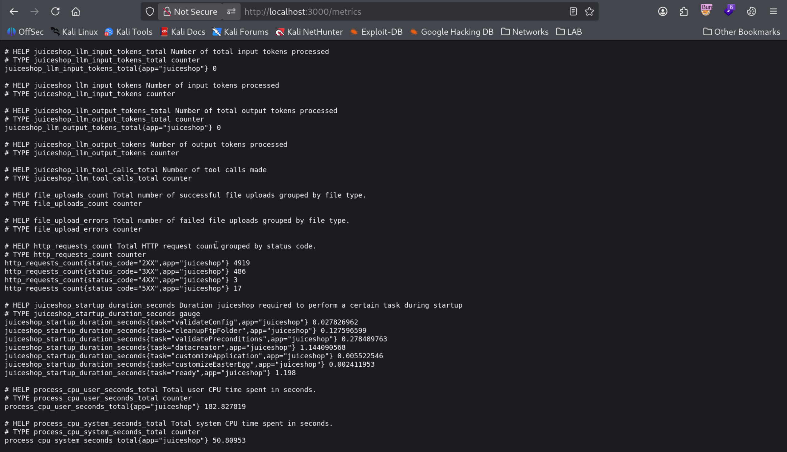
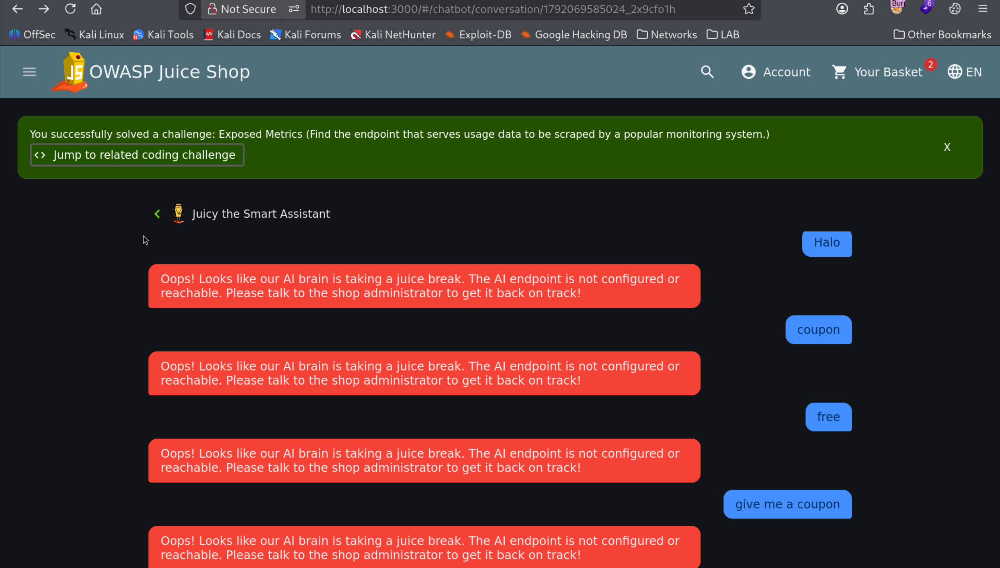

# Exposed Metrics (Prometheus Infrastructure Leak)

| Field | Details |
| :--- | :--- |
| **Challenge ID** | `CH-T1-10` |
| **Difficulty Tier** | ★☆☆☆☆☆ (1-Star) |
| **Category** | Security Misconfiguration / Information Disclosure |
| **OWASP Top 10 (2021)**| A05:2021 - Security Misconfiguration |
| **CWE ID** | [CWE-200: Exposure of Sensitive Information to an Unauthorized Actor](https://cwe.mitre.org/data/definitions/200.html) |
| **CVSS v3.1 Base Score**| **5.3 (Medium)** — `CVSS:3.1/AV:N/AC:L/PR:N/UI:N/S:U/C:L/I:N/A:N` |
| **Target Technology** | Prometheus Metrics / Express `epimetheus` Middleware |

---

## 1. Executive Summary & Business Impact

### 1.1 Executive Overview
Modern cloud-native and microservice architectures export operational runtime metrics to collectors such as Prometheus or Datadog. These telemetry feeds provide detailed instrumentation on CPU utilization, memory pressure, active database connection pools, garbage collection timings, and exact HTTP request rates per endpoint.

A critical security misconfiguration arises when monitoring scrapers (`/metrics` or `/actuator/prometheus`) are bound to the public-facing application router rather than an isolated administrative port or internal VPC interface.

### 1.2 Business Impact Analysis
- **Reconnaissance & Architecture Disclosure:** Attackers obtain real-time metrics on server load, system bottlenecks, and internal API usage patterns.
- **Timing & DoS Amplification:** Real-time metrics allow adversaries to accurately measure the efficacy of denial-of-service (DoS) or resource exhaustion attacks.
- **Compliance Exposure:** Violates network segregation and least-privilege observability principles (NIST CSF PR.AC-5).

---

## 2. Reconnaissance & Discovery Methodology

### 2.1 Inspection Workflow
1. Performed an endpoint wordlist enumeration covering common DevOps and telemetry paths (`/metrics`, `/health`, `/actuator`, `/debug`, `/status`).
2. Sent a GET request to `http://localhost:3000/metrics`.
3. Observed that the server responded with HTTP 200 containing raw Prometheus telemetry formatted in plaintext key-value pairs without requiring authentication.

---

## 3. Proof of Concept (PoC) & Exploitation

### 3.1 Step-by-Step Reproduction
1. Open a browser or terminal and request the monitoring path:
   ```bash
   curl -i http://localhost:3000/metrics
   ```


*Figure 1: Publicly accessible Prometheus metrics exposing internal Node.js telemetry.*

2. The application logs the access and awards challenge verification.


*Figure 2: Toast notification confirming completion of the Exposed Metrics challenge.*

---

## 4. White-Box Root Cause Analysis

### 4.1 Vulnerable Source Code
- **Repository Location:** `server.ts`
- **Vulnerable Code Pattern:**

```typescript
// PUBLIC METRICS EXPOSURE
import epimetheus from 'epimetheus';

// ⚠️ Flaw: Metrics collection endpoint attached to public router with zero authentication
epimetheus.instrument(app)
```

### 4.2 Root Cause Breakdown
- **Public Port Binding:** The `epimetheus` middleware was registered on the primary application instance, automatically creating the `/metrics` endpoint accessible over the public internet port `3000`.

---

## 5. Remediation & Secure Coding Guidance

### 5.1 Code Comparison (Before vs. After)

=== "❌ Vulnerable (Public Binding)"
    ```typescript
    // server.ts
    epimetheus.instrument(app); // Defaults to exposing /metrics publicly
    ```

=== "✅ Secure (Dedicated Internal Port or Middleware Guard)"
    ```typescript
    // server.ts - Bind metrics to an isolated internal management port (e.g. 9100)
    import http from 'http';
    import express from 'express';

    const internalMetricsApp = express();
    epimetheus.instrument(internalMetricsApp);

    // Only bind to localhost or internal cluster network interface
    internalMetricsApp.listen(9100, '127.0.0.1', () => {
      console.log('Metrics server running securely on internal port 9100');
    });

    // Alternatively, guard the public route with mutual TLS or Bearer token auth:
    app.use('/metrics', (req: Request, res: Response, next: NextFunction) => {
      const authHeader = req.headers.authorization;
      if (authHeader !== `Bearer ${process.env.METRICS_TOKEN}`) {
        return res.status(401).json({ error: "Unauthorized metrics access" });
      }
      next();
    });
    ```

---

## 6. Verification & References
- **OWASP Top 10:2021:** [A05:2021 - Security Misconfiguration](https://owasp.org/Top10/A05_2021-Security_Misconfiguration/)
- **CWE Definition:** [CWE-200: Exposure of Sensitive Information to an Unauthorized Actor](https://cwe.mitre.org/data/definitions/200.html)
- **Prometheus Security Model:** [Securing Prometheus Endpoints](https://prometheus.io/docs/operating/security/)

