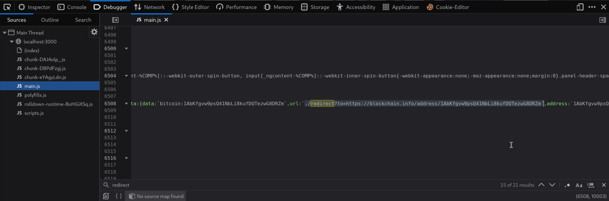
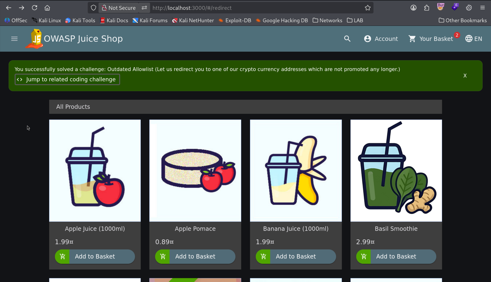

# Outdated Whitelist (Open Redirect via Legacy Address)

| Field | Details |
| :--- | :--- |
| **Challenge ID** | `CH-T1-09` |
| **Difficulty Tier** | ★☆☆☆☆☆ (1-Star) |
| **Category** | Unvalidated Redirects and Forwards / Broken Access Control |
| **OWASP Top 10 (2021)**| A01:2021 - Broken Access Control |
| **CWE ID** | [CWE-601: URL Redirection to Untrusted Site ('Open Redirect')](https://cwe.mitre.org/data/definitions/601.html) |
| **CVSS v3.1 Base Score**| **4.7 (Medium)** — `CVSS:3.1/AV:N/AC:L/PR:N/UI:R/S:C/C:N/I:L/A:N` |
| **Target Technology** | Express.js Redirection Middleware |

---

## 1. Executive Summary & Business Impact

### 1.1 Executive Overview
Web applications often utilize redirection endpoints (e.g. `/redirect?to=...`) to route users to external payment gateways, documentation, or social platforms. To prevent Open Redirect attacks (where attackers lure victims to phishing domains under the guise of a trusted company URL), developers implement domain whitelists.

A common lifecycle flaw occurs when whitelists are not regularly audited: legacy external domains, expired vendor services, or deprecated cryptocurrency donation addresses remain whitelisted long after the organization ceases using them.

### 1.2 Business Impact Analysis
- **Phishing Credibility Amplification:** Attackers construct phishing campaigns using the trusted primary domain (`https://trusted-site.com/redirect?to=https://attacker-domain.com`).
- **Reputational Degradation:** Association with abandoned third-party services or domain takeovers.

---

## 2. Reconnaissance & Discovery Methodology

### 2.1 Inspection Workflow
1. Located the redirect controller in the server code (`routes/redirect.ts`).
2. Inspected the URL parameter verification logic:
   ```typescript
   export function performRedirect () {
     return (req: Request, res: Response, next: NextFunction) => {
       const toUrl = req.query.to
       if (security.isAuthorizedUrl(toUrl)) {
         res.redirect(toUrl)
       } else {
         res.status(406).send('Unrecognized target URL')
       }
     }
   }
   ```
3. Audited the whitelist array inside `lib/utils.ts` and discovered an unmaintained legacy Bitcoin address on `blockchain.info`.

---

## 3. Proof of Concept (PoC) & Exploitation

### 3.1 Step-by-Step Reproduction
1. Dispatch an HTTP GET request to the redirect endpoint targeting the legacy whitelist entry:
   ```text
   http://localhost:3000/redirect?to=https://blockchain.info/address/1AbKfgHTnnJhmGCJk8R3mA7xNyHbgegCDT
   ```


*Figure 1: Executing redirection to the legacy cryptocurrency donation address.*

2. The application validates the target against its outdated whitelist and issues an HTTP 302 redirect.
3. Returning to the Score Board confirms the challenge has been completed.


*Figure 2: Toast notification confirming resolution of the Outdated Whitelist challenge.*

---

## 4. White-Box Root Cause Analysis

### 4.1 Vulnerable Source Code
- **Repository Location:** `lib/utils.ts`
- **Vulnerable Code Pattern:**

```typescript
// STALE WHITELIST CONFIGURATION
export const redirectWhitelist = [
  'https://github.com/bkimminich/juice-shop',
  // ⚠️ Flaw: Abandoned third-party cryptocurrency address remains trusted
  'https://blockchain.info/address/1AbKfgHTnnJhmGCJk8R3mA7xNyHbgegCDT',
  'https://gratipay.com/juice-shop'
]
```

### 4.2 Root Cause Breakdown
- **Stale Whitelist Hygiene:** Inadequate lifecycle auditing of authorized external domains allowed deprecated URLs to retain trusted status within security routing middleware.

---

## 5. Remediation & Secure Coding Guidance

### 5.1 Code Comparison (Before vs. After)

=== "❌ Vulnerable (Static Unmonitored Whitelist)"
    ```typescript
    // utils.ts
    export const redirectWhitelist = [
      'https://blockchain.info/address/1AbKfgHTnnJhmGCJk8R3mA7xNyHbgegCDT'
    ];
    ```

=== "✅ Secure (Strict Relative Redirects or Explicit Confirmation Modal)"
    ```typescript
    // routes/redirect.ts
    // Option A: Strictly restrict to relative local paths
    export function safeRedirect(req: Request, res: Response) {
      const target = req.query.to as string;
      
      // Ensure target begins with a single '/' and not '//' (protocol-relative)
      if (target && target.startsWith('/') && !target.startsWith('//')) {
        return res.redirect(target);
      }
      
      // Option B: For external redirects, route through an interstitial warning screen
      return res.status(400).json({ error: "External redirects require explicit user consent" });
    }
    ```

---

## 6. Verification & References
- **OWASP Top 10:2021:** [A01:2021 - Broken Access Control](https://owasp.org/Top10/A01_2021-Broken_Access_Control/)
- **CWE Definition:** [CWE-601: URL Redirection to Untrusted Site ('Open Redirect')](https://cwe.mitre.org/data/definitions/601.html)
- **OWASP Cheat Sheet:** [Unvalidated Redirects and Forwards Cheat Sheet](https://cheatsheetseries.owasp.org/cheatsheets/Unvalidated_Redirects_and_Forwards_Cheat_Sheet.html)
