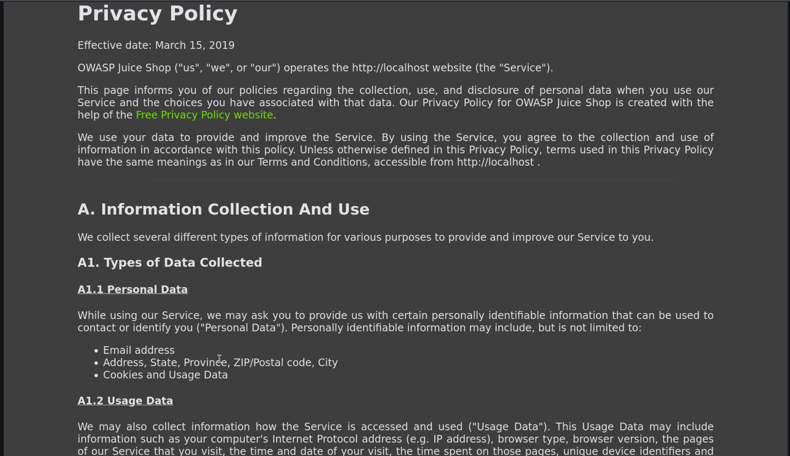
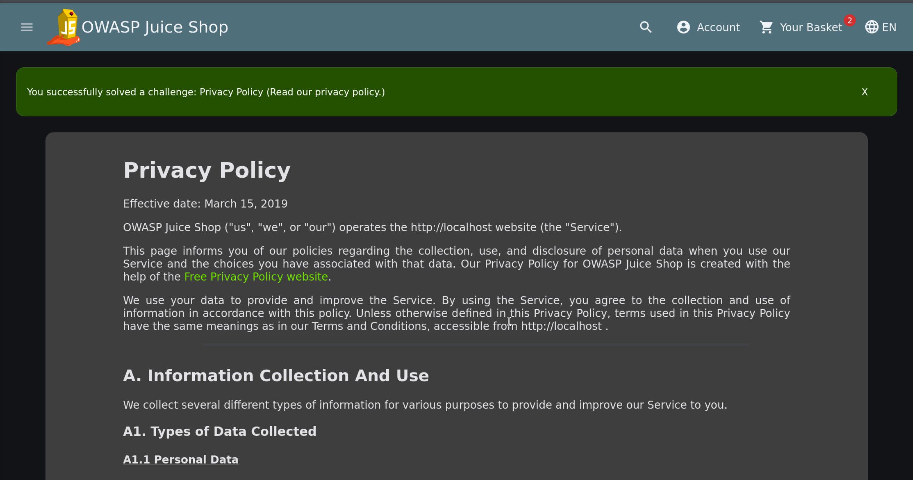

# Privacy Policy Inspection

| Field | Details |
| :--- | :--- |
| **Challenge ID** | `CH-T1-08` |
| **Difficulty Tier** | ★☆☆☆☆☆ (1-Star) |
| **Category** | Information Gathering / Reconnaissance |
| **OWASP Top 10 (2021)**| A05:2021 - Security Misconfiguration |
| **CWE ID** | [CWE-200: Exposure of Sensitive Information to an Unauthorized Actor](https://cwe.mitre.org/data/definitions/200.html) |
| **CVSS v3.1 Base Score**| **2.6 (Low)** — `CVSS:3.1/AV:N/AC:L/PR:N/UI:N/S:U/C:L/I:N/A:N` |
| **Target Technology** | Angular Single Page Application Navigation |

---

## 1. Executive Summary & Business Impact

### 1.1 Executive Overview
During the reconnaissance phase of a web application security assessment, auditors analyze public disclosures, legal statements, and privacy policies. Privacy policies frequently enumerate internal data handling practices, third-party analytics vendors, data retention schedules, and cross-border data transfer protocols.

In this introductory challenge, the privacy policy route (`/#/privacy-security/privacy-policy`) is navigated to verify compliance with privacy disclosure mandates and inspect declared security controls.

### 1.2 Business Impact Analysis
- **Regulatory Compliance:** Under global privacy regulations (GDPR Article 13/14, CCPA, and Indonesia UU PDP Article 20), organizations must provide clear, accessible transparency notices regarding personal data collection.
- **Third-Party Risk Assessment:** Identifying declared third-party sub-processors assists security auditors in mapping external data flows.

---

## 2. Reconnaissance & Discovery Methodology

### 2.1 Inspection Workflow
1. Inspected the application's sidebar and footer navigation trees.
2. Located the nested route under `Privacy & Security` -> `Privacy Policy`.
3. Verified the client route path in `app.routing.ts`:
   ```text
   /#/privacy-security/privacy-policy
   ```

---

## 3. Proof of Concept (PoC) & Exploitation

### 3.1 Step-by-Step Reproduction
1. Open the application at `http://localhost:3000`.
2. Navigate via menu: Click **Account** -> **Privacy & Security** -> **Privacy Policy** (or enter direct URL `http://localhost:3000/#/privacy-security/privacy-policy`).


*Figure 1: Successfully navigating to and rendering the Privacy Policy component.*

3. The application registers the route visit and presents the challenge completion notification.


*Figure 2: Toast notification confirming the challenge completion.*

---

## 4. White-Box Analysis & Best Practices

### 4.1 Route Architecture
- **Component:** `privacy-policy.component.ts`
- **Assessment Consideration:** While public access to privacy notices is legally mandated, security teams must verify that the privacy policy accurately reflects the technical reality of the application's cookies, third-party trackers, and data retention implementations.

---

## 5. References
- **OWASP Top 10:2021:** [A05:2021 - Security Misconfiguration](https://owasp.org/Top10/A05_2021-Security_Misconfiguration/)
- **CWE Definition:** [CWE-200: Exposure of Sensitive Information](https://cwe.mitre.org/data/definitions/200.html)
- **GDPR Compliance Guide:** [GDPR Transparency and Privacy Notices](https://gdpr.eu/privacy-notice/)
