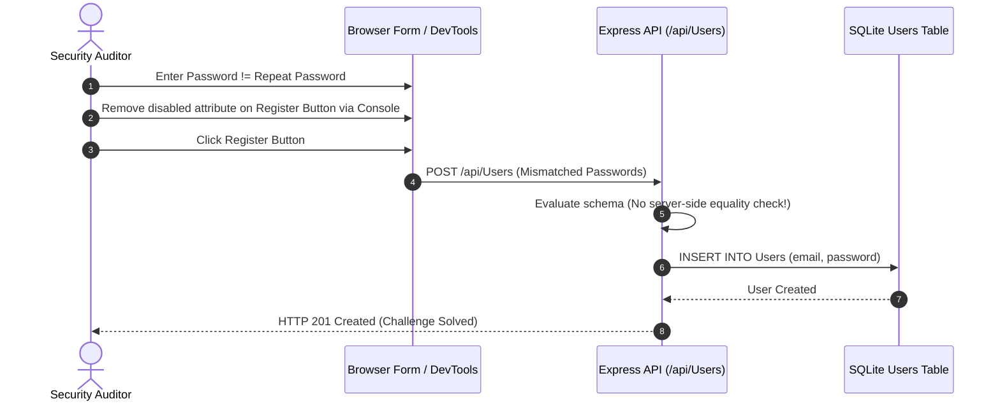
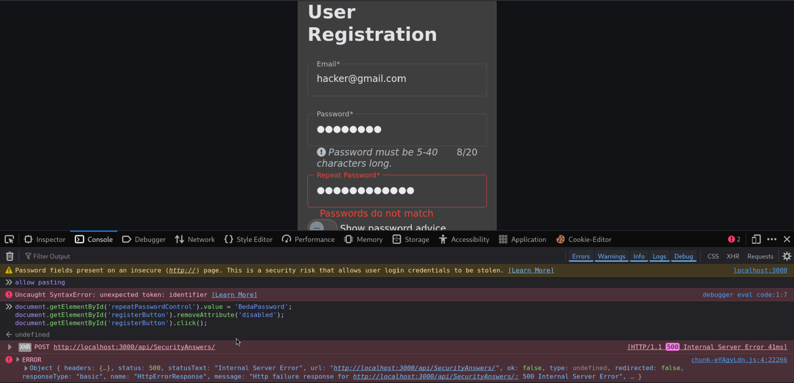
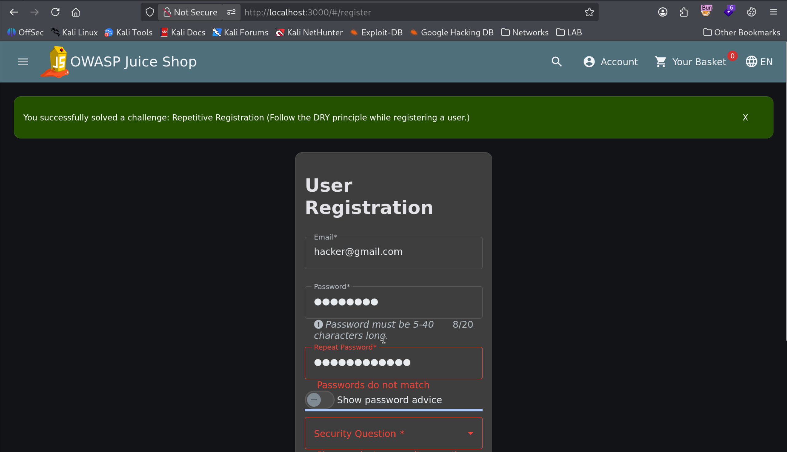

# Repetitive Registration (Client-Side Only Validation Bypass)

| Field | Details |
| :--- | :--- |
| **Challenge ID** | `CH-T1-06` |
| **Difficulty Tier** | ★☆☆☆☆☆ (1-Star) |
| **Category** | Improper Input Validation / Insecure Design |
| **OWASP Top 10 (2021)**| A04:2021 - Insecure Design |
| **CWE ID** | [CWE-602: Client-Side Enforcement of Server-Side Security](https://cwe.mitre.org/data/definitions/602.html) |
| **CVSS v3.1 Base Score**| **4.3 (Medium)** — `CVSS:3.1/AV:N/AC:L/PR:N/UI:N/S:U/C:N/I:L/A:N` |
| **Target Technology** | Angular Reactive Forms vs Express User Route |

---

## 1. Executive Summary & Business Impact

### 1.1 Executive Overview
Modern web applications frequently validate form inputs on the client side using frontend framework validators to provide responsive UX feedback (e.g. confirming that "Repeat Password" matches "Password"). A critical security vulnerability arises when development teams treat client-side validation as a security boundary and fail to enforce identical validation rules at the backend API layer.

In this assessment, the user registration page enforces password matching solely within the Angular client UI. An attacker can manipulate DOM properties or submit direct API payloads where the repeated password does not match, which the server processes without verification.

### 1.2 Business Impact Analysis
- **Data Integrity:** Allows corrupted, malformed, or automated rogue user accounts to be provisioned.
- **Account Recovery Lockout:** If a user mistypes their initial password while bypassing confirmation, they may lock themselves out of newly created accounts.
- **Violations of Secure Coding Baselines:** Demonstrates absence of unified input validation architectures across client and server boundaries.

---

## 2. Reconnaissance & Discovery Methodology

### 2.1 Inspection Workflow
1. Inspected the registration form at `http://localhost:3000/#/register`.
2. Reviewed the network traffic when the registration form is submitted. The client makes a JSON POST request to `/api/Users`.
3. Observed the payload body:
   ```json
   {
     "email": "user@target.com",
     "password": "Password123!",
     "passwordRepeat": "Password123!",
     "securityQuestion": { ... },
     "securityAnswer": "..."
   }
   ```
4. Discovered that the backend User model schema only indexes `email` and `password`, ignoring `passwordRepeat` entirely.

### 2.2 Attack Surface Sequence


---

## 3. Proof of Concept (PoC) & Exploitation

### 3.1 Step-by-Step Reproduction
1. Navigate to `http://localhost:3000/#/register`.
2. Fill in the email, password, and security question.
3. Open Developer Tools Console (`F12`) and supply mismatched password parameters while clearing the submit button's disabled state:
   ```javascript
   document.getElementById('repeatPasswordControl').value = 'CompletelyDifferentPassword';
   document.getElementById('registerButton').removeAttribute('disabled');
   document.getElementById('registerButton').click();
   ```


*Figure 1: Client-side registration form successfully submitted with non-matching password confirmation.*

4. The server accepts the registration, creating the user and completing the challenge.


*Figure 2: Toast notification confirming resolution of the Repetitive Registration challenge.*

---

## 4. White-Box Root Cause Analysis

### 4.1 Vulnerable Source Code
- **Repository Location:** `routes/register.ts`
- **Vulnerable Code Pattern:**

```typescript
// INSECURE BACKEND REGISTRATION HANDLER
export function register () {
  return (req: Request, res: Response, next: NextFunction) => {
    // ⚠️ Flaw: Backend takes req.body directly without validating equality of password and passwordRepeat
    UserModel.create({
      email: req.body.email,
      password: req.body.password,
      role: roles.customer
    })
    .then((user: User) => {
      res.status(201).json({ status: 'success', data: user })
    })
    .catch((error: Error) => {
      next(error)
    })
  }
}
```

### 4.2 Root Cause Breakdown
- **Client-Side Reliance:** The backend completely trusts incoming HTTP parameters, assuming that because the Angular UI checked `password === passwordRepeat`, no mismatched request could ever reach the server.

---

## 5. Remediation & Secure Coding Guidance

### 5.1 Code Comparison (Before vs. After)

=== "❌ Vulnerable (Trusting Client Input)"
    ```typescript
    // routes/register.ts
    UserModel.create({
      email: req.body.email,
      password: req.body.password
    });
    ```

=== "✅ Secure (Server-Side Schema Validation via Joi/Zod)"
    ```typescript
    import { z } from 'zod';

    // Strict registration schema enforced on API boundary
    const RegistrationSchema = z.object({
      email: z.string().email(),
      password: z.string().min(8),
      passwordRepeat: z.string().min(8),
    }).refine((data) => data.password === data.passwordRepeat, {
      message: "Passwords do not match",
      path: ["passwordRepeat"],
    });

    export function registerSecure () {
      return async (req: Request, res: Response, next: NextFunction) => {
        const validation = RegistrationSchema.safeParse(req.body);
        if (!validation.success) {
          return res.status(400).json({ errors: validation.error.format() });
        }

        // Proceed with user creation
        const user = await UserModel.create({
          email: validation.data.email,
          password: security.hashPassword(validation.data.password),
          role: roles.customer
        });
        res.status(201).json({ status: 'success', data: user });
      };
    }
    ```

---

## 6. Verification & References
- **OWASP Top 10:2021:** [A04:2021 - Insecure Design](https://owasp.org/Top10/A04_2021-Insecure_Design/)
- **CWE Definition:** [CWE-602: Client-Side Enforcement of Server-Side Security](https://cwe.mitre.org/data/definitions/602.html)
- **OWASP Cheat Sheet:** [Input Validation Cheat Sheet](https://cheatsheetseries.owasp.org/cheatsheets/Input_Validation_Cheat_Sheet.html)
