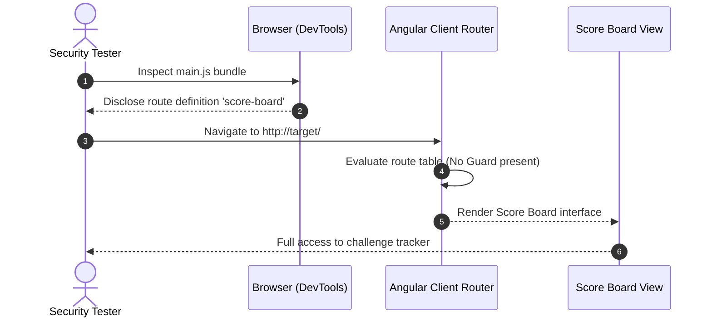
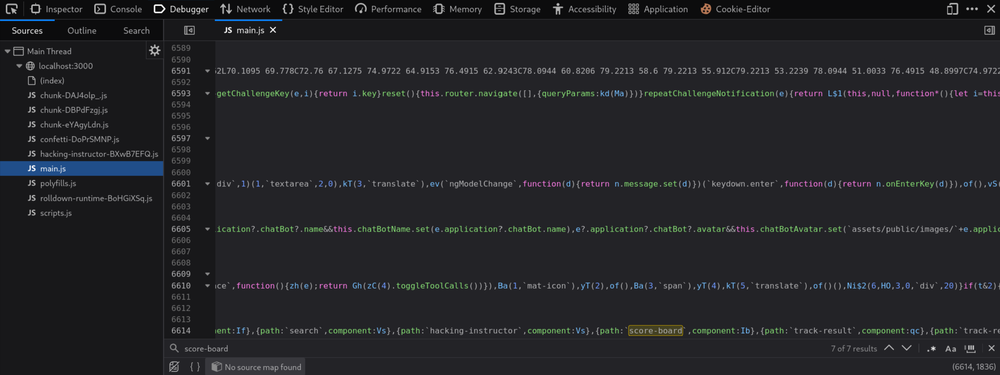
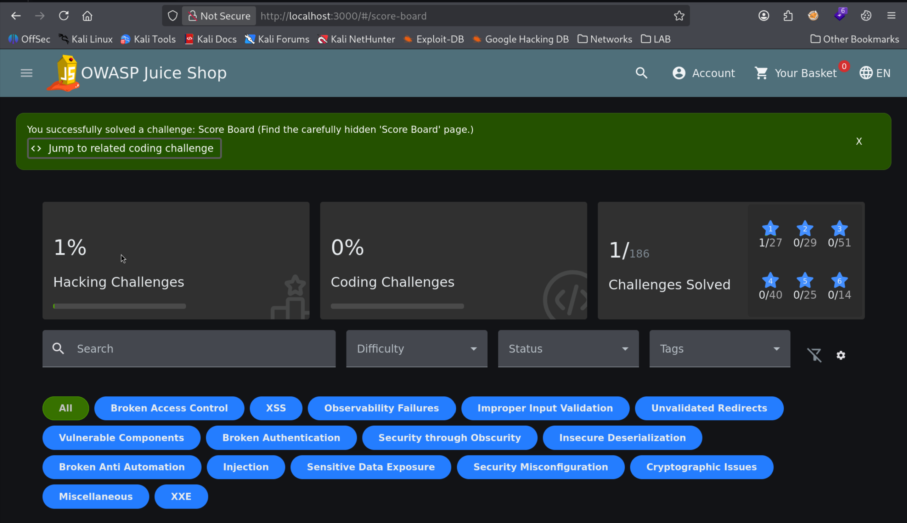

# Finding the Hidden Score Board

| Field | Details |
| :--- | :--- |
| **Challenge ID** | `CH-T1-01` |
| **Difficulty Tier** | ★☆☆☆☆☆ (1-Star) |
| **Category** | Security Misconfiguration / Information Disclosure |
| **OWASP Top 10 (2021)**| A05:2021 - Security Misconfiguration |
| **CWE ID** | [CWE-200: Exposure of Sensitive Information to an Unauthorized Actor](https://cwe.mitre.org/data/definitions/200.html) |
| **CVSS v3.1 Base Score**| **3.1 (Low)** — `CVSS:3.1/AV:N/AC:L/PR:N/UI:N/S:U/C:L/I:N/A:N` |
| **Target Technology** | Angular (SPA) / TypeScript Routing |

---

## 1. Executive Summary & Business Impact

### 1.1 Executive Overview
Modern Single Page Applications (SPAs) built with frameworks like Angular or React compile routing rules into client-side JavaScript bundles. In this application, developers intentionally hid the **Score Board** challenge tracker from standard navigation menus, assuming that omitting visible UI links would prevent unauthorized or public access. 

This anti-pattern is known as **Security through Obscurity**. Because the entire routing table is delivered directly to the end-user's browser, unauthenticated visitors can reverse-engineer internal paths and access administrative or unlisted functionality directly.

### 1.2 Business Impact Analysis
- **Confidentiality:** Exposure of internal operational dashboards, system tracking metrics, or unreleased feature interfaces to untrusted parties.
- **Integrity:** Potential reconnaissance leverage for attackers to discover high-value endpoints or debug interfaces.
- **Compliance & Governance:** Failure to enforce strict role-based access control (RBAC) at both client and server boundaries violates principle-of-least-privilege guidelines (NIST SP 800-53, ISO 27001).

---

## 2. Reconnaissance & Discovery Methodology

### 2.1 Inspection Workflow
1. Opened the target web application at `http://localhost:3000` using Google Chrome Developer Tools (`F12`).
2. Navigated to the **Sources** tab to analyze loaded client-side bundles under `localhost:3000`.
3. Located the primary compiled application bundle (`main.js`).
4. Reformatted the minified JavaScript using the **Pretty-print** (`{}`) utility to facilitate source inspection.
5. Executed a targeted string query (`Ctrl + F`) searching for route declarations matching `score-board` and `path:`.
6. Discovered the unauthenticated client-side route definition:
   ```javascript
   { path: "score-board", component: ScoreBoardComponent }
   ```

### 2.2 Attack Surface Sequence


---

## 3. Proof of Concept (PoC) & Exploitation

> [!NOTE]
> Testing was performed in a local, isolated Docker container environment for defensive audit purposes.

### 3.1 Step-by-Step Reproduction
1. Launch the application in the web browser at `http://localhost:3000`.
2. Inspect `main.js` in DevTools to confirm the route naming convention.


*Figure 1: Client-side source code audit in Developer Tools revealing the unlisted `score-board` route.*

3. Manually append `/#/score-board` to the browser address bar:
   ```http
   GET /#/score-board HTTP/1.1
   Host: localhost:3000
   ```
4. The Angular client immediately resolves the route and instantiates the `ScoreBoardComponent`.
5. The application confirms verification of the vulnerability with a success notification banner.


*Figure 2: Accessing the Score Board interface and receiving the challenge resolution notification.*

---

## 4. White-Box Root Cause Analysis

### 4.1 Vulnerable Source Code
- **Repository File:** `frontend/src/app/app.routing.ts`
- **Component:** `ScoreBoardComponent`

```typescript
// VULNERABLE ROUTE CONFIGURATION
const routes: Routes = [
  {
    path: 'score-board',
    component: ScoreBoardComponent
    // ⚠️ Flaw: No route guard (canActivate) is attached to enforce authentication or role verification
  },
  // ... other routes
]
```

### 4.2 Root Cause Breakdown
- **Client-Side Absence of Guards:** The Angular router configuration defines `score-board` as a public top-level route without implementing an Angular `CanActivate` guard interface.
- **Architectural Misconception:** Reliance on UI menu omission rather than cryptographic or state-based access verification to restrict sensitive views.

---

## 5. Remediation & Secure Coding Guidance

### 5.1 Code Comparison (Before vs. After)

=== "❌ Vulnerable (Current Implementation)"
    ```typescript
    // frontend/src/app/app.routing.ts
    // Route is publicly resolvable by any visitor
    export const routes: Routes = [
      {
        path: 'score-board',
        component: ScoreBoardComponent
      }
    ];
    ```

=== "✅ Secure (Patched Implementation)"
    ```typescript
    // frontend/src/app/app.routing.ts
    import { AuthGuard } from './guards/auth.guard';
    import { RoleGuard } from './guards/role.guard';

    export const routes: Routes = [
      {
        path: 'score-board',
        component: ScoreBoardComponent,
        canActivate: [AuthGuard, RoleGuard],
        data: { expectedRole: 'ROLE_ADMIN' }
      }
    ];
    ```

### 5.2 Defense-in-Depth Measures
1. **Server-Side API Authorization:** Frontend route guards provide user experience protection, but the backend API endpoint serving scorecard data (`/api/Challenges`) must independently validate the user's JWT token and permissions on every request.
2. **Bundle Hardening:** In production applications, administrative routes and components should be encapsulated in lazily-loaded feature modules (`loadChildren`) accessible only after successful authentication, reducing the footprint of the public `main.js` bundle.

---

## 6. Verification & References

### 6.1 Retesting Procedure
1. Apply the `canActivate: [AuthGuard]` guard to the route configuration.
2. Attempt direct navigation to `http://localhost:3000/#/score-board` in an unauthenticated browser session.
3. Confirm that the application redirects the user to `/#/login` with an access-denied flash message.

### 6.2 Industry Standards & References
- **OWASP Top 10:2021:** [A05:2021 - Security Misconfiguration](https://owasp.org/Top10/A05_2021-Security_Misconfiguration/)
- **CWE Definition:** [CWE-200: Exposure of Sensitive Information to an Unauthorized Actor](https://cwe.mitre.org/data/definitions/200.html)
- **Angular Documentation:** [Controlling Access with Route Guards](https://angular.io/guide/router-tutorial-toh#milestone-5-route-guards)
- **OWASP Cheat Sheet:** [Authorization Cheat Sheet](https://cheatsheetseries.owasp.org/cheatsheets/Authorization_Cheat_Sheet.html)

