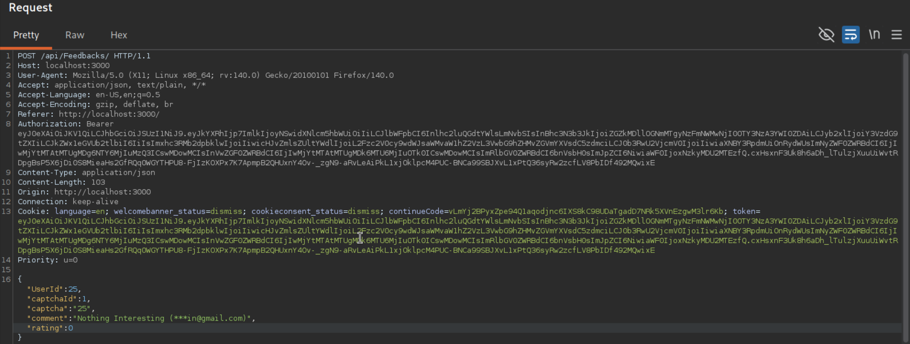
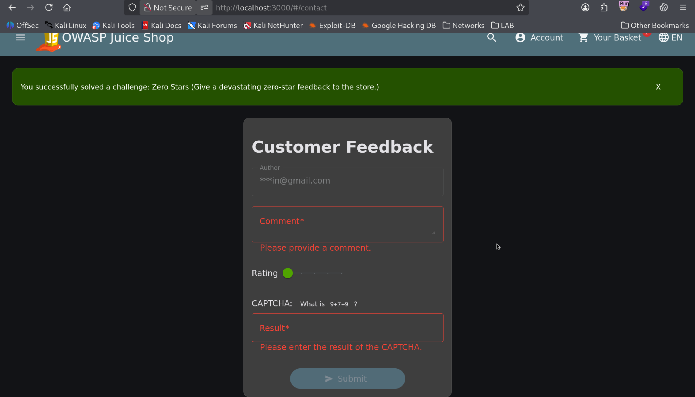

# Zero Stars Feedback (Business Logic & Boundary Bypass)

| Field | Details |
| :--- | :--- |
| **Challenge ID** | `CH-T1-07` |
| **Difficulty Tier** | ★☆☆☆☆☆ (1-Star) |
| **Category** | Improper Input Validation / Business Logic Flaw |
| **OWASP Top 10 (2021)**| A04:2021 - Insecure Design |
| **CWE ID** | [CWE-20: Improper Input Validation](https://cwe.mitre.org/data/definitions/20.html) |
| **CVSS v3.1 Base Score**| **4.3 (Medium)** — `CVSS:3.1/AV:N/AC:L/PR:N/UI:N/S:U/C:N/I:L/A:N` |
| **Target Technology** | Angular Slider Component / Express Feedback API |

---

## 1. Executive Summary & Business Impact

### 1.1 Executive Overview
E-commerce and review platforms rely on strict rating rating boundaries (typically 1 to 5 stars) to calculate accurate product quality indices, merchant trust metrics, and recommendation algorithms. When boundary constraints are applied solely via user interface controls (such as Angular Material sliders) without backend mathematical enforcement, users can bypass limits through direct API manipulation.

In this assessment, the customer feedback mechanism prevented users from selecting fewer than 1 star within the graphical interface. However, transmitting a rating value of `0` directly via an intercepted API request was accepted and stored by the database.

### 1.2 Business Impact Analysis
- **Data Integrity Corruption:** Submitting out-of-bounds ratings skews algorithmic averages, reviews, and automated recommendation engines.
- **Potential Negative Rating Denial of Service:** In poorly implemented average calculations, unexpected values (0 or negative integers) can lead to division-by-zero errors or broken analytics pipelines.

---

## 2. Reconnaissance & Discovery Methodology

### 2.1 Inspection Workflow
1. Navigated to the Customer Feedback page (`/#/contact`).
2. Observed the rating widget implemented using an Angular Material `<mat-slider>` component configured with `min="1"` and `max="5"`.
3. Intercepted the form submission request in Burp Suite / Browser Network tab:
   ```http
   POST /api/Feedbacks HTTP/1.1
   Host: localhost:3000
   Content-Type: application/json

   {
     "comment": "Sample feedback",
     "rating": 1
   }
   ```
4. Hypothesized that the backend does not validate minimum integer boundaries.

---

## 3. Proof of Concept (PoC) & Exploitation

### 3.1 Step-by-Step Reproduction
1. Open the Customer Feedback page at `http://localhost:3000/#/contact`.
2. Enter a feedback comment and solve the visual CAPTCHA.
3. Open Developer Tools Console (`F12`) and dispatch an unconstrained API request:
   ```javascript
   fetch('/api/Feedbacks', {
     method: 'POST',
     headers: { 'Content-Type': 'application/json' },
     body: JSON.stringify({ comment: "Devastating review", rating: 0 })
   }).then(r => r.json()).then(data => console.log("Response:", data));
   ```


*Figure 1: Executing an out-of-bounds rating payload of 0 stars via client console.*

4. The API responds with `201 Created`, storing the zero-star review and solving the challenge.


*Figure 2: Toast notification confirming the Zero Stars feedback submission.*

---

## 4. White-Box Root Cause Analysis

### 4.1 Vulnerable Source Code
- **Repository Location:** `data/static/models/feedback.ts`
- **Vulnerable Code Pattern:**

```typescript
// INSECURE DATABASE SCHEMA DEFINITION
Feedback.init({
  comment: {
    type: DataTypes.STRING,
    allowNull: false
  },
  rating: {
    type: DataTypes.INTEGER,
    allowNull: false
    // ⚠️ Flaw: Missing Sequelize validation bounds (min: 1, max: 5)
  }
}, { sequelize, modelName: 'Feedback' })
```

### 4.2 Root Cause Breakdown
- **Missing ORM Model Constraints:** The database column definition accepts any valid integer without specifying Sequelize validation constraints (`validate: { min: 1, max: 5 }`).

---

## 5. Remediation & Secure Coding Guidance

### 5.1 Code Comparison (Before vs. After)

=== "❌ Vulnerable (Unconstrained Integer)"
    ```typescript
    rating: {
      type: DataTypes.INTEGER,
      allowNull: false
    }
    ```

=== "✅ Secure (Sequelize Model Validation Bounds)"
    ```typescript
    rating: {
      type: DataTypes.INTEGER,
      allowNull: false,
      validate: {
        isInt: true,
        min: 1,
        max: 5
      }
    }
    ```

---

## 6. Verification & References
- **OWASP Top 10:2021:** [A04:2021 - Insecure Design](https://owasp.org/Top10/A04_2021-Insecure_Design/)
- **CWE Definition:** [CWE-20: Improper Input Validation](https://cwe.mitre.org/data/definitions/20.html)
- **Sequelize Docs:** [Model Validations](https://sequelize.org/docs/v6/core-concepts/validations-and-constraints/)
