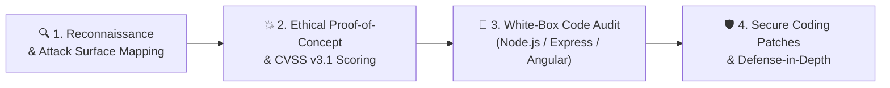
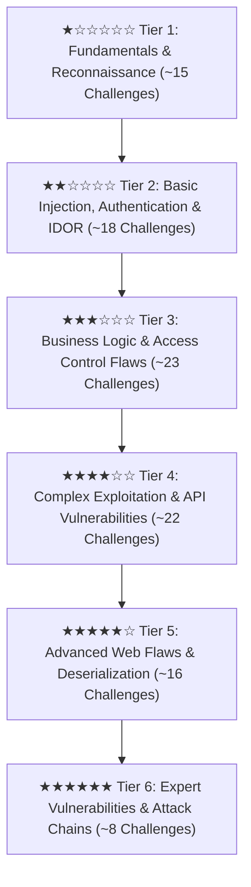

# 🛡️ OWASP Juice Shop Application Security Portfolio

> **A deep-dive, industry-grade security audit and white-box vulnerability assessment of the OWASP Juice Shop application, covering 100+ challenges across all 6 difficulty tiers.**

---

## 📌 Executive Overview

This repository and documentation suite serves as an **Application Security (AppSec) Engineering & Web Penetration Testing Portfolio**. Rather than simply documenting exploit payloads or CTF flags, this project demonstrates an end-to-end security engineering approach:

Each write-up adheres to enterprise vulnerability reporting standards, connecting business risk with technical root causes and developer remediation guides.

---

## 📊 Key Highlights & Target Metrics

| Metric | Target | Status |
| :--- | :---: | :---: |
| **Total Challenges Solved** | **100+ Challenges** | In Progress (Tier 1 Underway) |
| **Difficulty Coverage** | **Tier 1★ through Tier 6★** | Complete Spectrum |
| **OWASP Top 10 (2021)** | **10 / 10 Categories** | 100% Taxonomy Mapped |
| **Root Cause Analysis** | **Source Code Audit per Challenge** | Included in all Write-ups |
| **Remediation Guides** | **Before vs. After Code Patches** | Production-ready Snippets |

---

## 🧭 Project Roadmap by Difficulty Tiers

Explore each tier:
- [**Tier 1 (1-Star Basics)**](challenges/tier-1/index.md): Client-side security, error handling, unauthenticated endpoints, and basic recon.
- [**Tier 2 (2-Star Intermediate)**](challenges/tier-2/index.md): SQL injection, broken authentication, IDOR, and deprecated APIs.
- [**Tier 3 (3-Star Advanced)**](challenges/tier-3/index.md): CSRF, XXE, cryptographic issues, and database bypasses.
- [**Tier 4 (4-Star Complex)**](challenges/tier-4/index.md): JWT manipulation, NoSQL injection, SSRF, and access escalation.
- [**Tier 5 (5-Star Hard)**](challenges/tier-5/index.md): Insecure deserialization, template injection (SSTI), and blind injection.
- [**Tier 6 (6-Star Expert)**](challenges/tier-6/index.md): Sophisticated attack chains, arbitrary code execution (RCE), and race conditions.

---

## 🔬 Testing Standards & Methodologies

- **Testing Standard:** [OWASP Web Security Testing Guide (WSTG v4.2)](methodology/testing-framework.md)
- **Scoring Methodology:** [Common Vulnerability Scoring System (CVSS v3.1)](https://www.first.org/cvss/v3.1/specification-document)
- **Taxonomy:** [OWASP Top 10:2021](progress/owasp-matrix.md) & [MITRE CWE](https://cwe.mitre.org/)
- **Remediation Reference:** [OWASP Secure Coding Practices & Cheat Sheets](secure-coding/node-express-angular.md)

---

## 👤 Author & Lab Context
- **Researcher:** [Hyphen-14](about.md)
- **Target Application:** OWASP Juice Shop (v17+)
- **Lab Environment:** Isolated Docker Container hosted inside a dedicated Kali Linux Virtual Machine.
- **Tools Utilized:** Burp Suite Professional/Community, Chrome DevTools, curl, Python3, Git.

