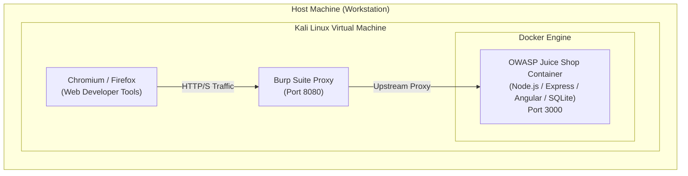

# Laboratory Environment & Testing Architecture

To ensure consistent testing, complete isolation, and rapid state restoration, the entire testing suite runs in a dedicated virtualization architecture.

---

## 1. Architecture Topology



---

## 2. Component Specifications

### 2.1 Target Application (OWASP Juice Shop)
- **Container Image:** `bkimminich/juice-shop:latest`
- **Application Stack:**
  - **Frontend:** Angular Single Page Application (SPA), Angular Material
  - **Backend API:** Node.js, Express.js
  - **Databases:** SQLite (via Sequelize ORM), MarsDB / MongoDB (NoSQL)
  - **Tokens & State:** JSON Web Tokens (JWT), express-session
- **Deployment Command:**
  ```bash
  docker run -d --rm -p 3000:3000 --name juice-shop bkimminich/juice-shop
  ```

### 2.2 Security Testing Toolchain (Kali Linux)
- **Interception Proxy:** Burp Suite (Community / Professional)
  - Configured with CA certificate installed in the browser trust store.
  - Active extensions: Logger++, Auto-Repeater, JSON Web Tokens (JWT) Editor.
- **Client Analysis:** Chromium & Firefox Developer Tools (Network Inspector, Console, Storage, Sources).
- **Automation & Scripting:** Python 3 (`requests`, `beautifulsoup4`), curl, `sqlmap` (for verification).
- **Source Code Reference:** Upstream GitHub repository clone used for side-by-side white-box line auditing.

---

## 3. Laboratory Hygiene & State Management

- **Backup & Reset:** The lab can be restored to a clean state at any moment by restarting the Docker container:
  ```bash
  docker stop juice-shop && docker run -d --rm -p 3000:3000 --name juice-shop bkimminich/juice-shop
  ```
- **Evidence Archival:** All raw HTTP requests, responses, and screenshots are organized per challenge in the `assets/images/tier-X/` directory for reproducible audits.

