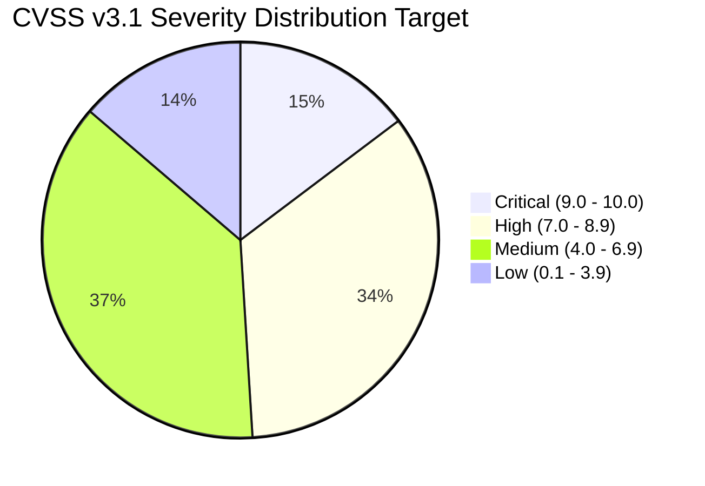

# Application Security Testing Framework

This document outlines the testing methodology, scoring rubric, and ethical rules of engagement followed throughout the OWASP Juice Shop security assessment.

---

## 1. Industry Standard Alignment

The assessment strictly aligns with the **OWASP Web Security Testing Guide (WSTG v4.2)** framework, which structures web application security testing across 12 distinct categories:

| WSTG ID | Category Description | Application in Juice Shop Audit |
| :--- | :--- | :--- |
| **WSTG-INFO** | Information Gathering & Reconnaissance | Endpoint discovery, robots.txt, client-side source map audits |
| **WSTG-CONF** | Configuration & Deployment Management | Server banners, error stack traces, CORS misconfigurations |
| **WSTG-IDNT** | Identity Management Testing | User enumeration, account registration flaws |
| **WSTG-ATHN** | Authentication Testing | SQL injection bypass, password reset weakness, brute-force |
| **WSTG-ATHZ** | Authorization Testing | Insecure Direct Object References (IDOR), privilege escalation |
| **WSTG-SESS** | Session Management Testing | JWT tampering, session fixation, token expiration analysis |
| **WSTG-INPV** | Input Validation Testing | XSS (DOM/Reflected), SQLi, NoSQLi, XXE, Command Injection |
| **WSTG-ERRH** | Error Handling | Leaked internal exceptions, database error disclosure |
| **WSTG-CRYP** | Cryptography | Weak ciphers, insecure hash algorithms (MD5/SHA1) |
| **WSTG-BUSL** | Business Logic Testing | Basket manipulation, checkout workflow bypasses |
| **WSTG-CLNT** | Client-Side Testing | DOM-based injection, HTML5 storage abuse, WebSockets |
| **WSTG-APIT** | API Testing | Mass assignment, unauthorized parameter inspection |

---

## 2. Vulnerability Scoring (CVSS v3.1)

Every vulnerability identified in this portfolio is scored according to the **CVSS v3.1 (Common Vulnerability Scoring System)** standard to establish objective severity:

### Metrics Evaluated:
- **Attack Vector (AV):** Network (`AV:N`) / Local (`AV:L`)
- **Attack Complexity (AC):** Low (`AC:L`) / High (`AC:H`)
- **Privileges Required (PR):** None (`PR:N`) / Low (`PR:L`) / High (`PR:H`)
- **User Interaction (UI):** None (`UI:N`) / Required (`UI:R`)
- **Scope (S):** Unchanged (`S:U`) / Changed (`S:C`)
- **Impact (CIA):** Confidentiality (C), Integrity (I), Availability (A)

---

## 3. White-Box Code Review Methodology

Unlike pure black-box penetration testing, this portfolio incorporates **White-Box Application Security Reviews**:

1. **Static Analysis & Inspection:**
   - Reviewing Angular frontend client bundles and component templates.
   - Inspecting Node.js / Express routes, middleware, and Sequelize ORM models.
2. **Root Cause Identification:**
   - Tracing untrusted inputs from the `req` object down to database queries or template rendering.
3. **Patch Engineering:**
   - Formulating functional, production-ready code fixes adhering to the principle of least privilege and defense-in-depth.

