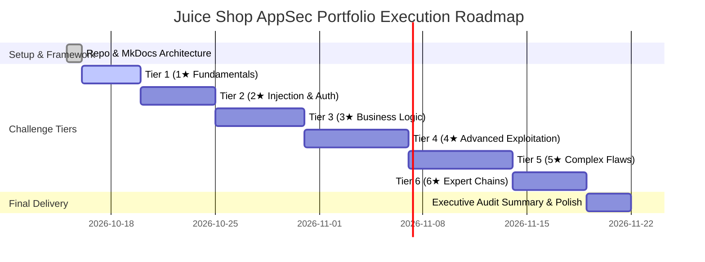

# Executive Progress Dashboard & Scorecard

Real-time tracking of vulnerability discovery, root-cause code audit, and remediation documentation across all OWASP Juice Shop challenges.

---

## 📈 Overall Completion Progress

| Metric | Completed | Total | Percentage |
| :--- | :---: | :---: | :---: |
| **All Challenges** | **11** | **102** | **10.8%** |
| **Tier 1 (★☆☆☆☆☆)** | 10 | 15 | 66.7% |
| **Tier 2 (★★☆☆☆☆)** | 1 | 18 | 5.6% |
| **Tier 3 (★★★☆☆☆)** | 0 | 23 | 0% |
| **Tier 4 (★★★★☆☆)** | 0 | 22 | 0% |
| **Tier 5 (★★★★★☆)** | 0 | 16 | 0% |
| **Tier 6 (★★★★★★)** | 0 | 8 | 0% |

---

## 🏆 Tier 1 Challenge Matrix (1-Star Basics)

| Status | Challenge Name | Category | OWASP 2021 | CWE | Write-up |
| :---: | :--- | :--- | :--- | :--- | :---: |
| ✅ Completed | Score Board Discovery | Miscellaneous | A05: Security Misconfig | CWE-200 | [View Report](../challenges/tier-1/score-board.md) |
| ✅ Completed | Error Handling Leak | Security Misconfig | A05: Security Misconfig | CWE-209 | [View Report](../challenges/tier-1/error-handling.md) |
| ✅ Completed | Confidential Document | Sensitive Data Exposure | A01: Broken Access Control | CWE-552 | [View Report](../challenges/tier-1/confidential-document.md) |
| ✅ Completed | DOM XSS | XSS | A03: Injection | CWE-79 | [View Report](../challenges/tier-1/dom-xss.md) |
| ✅ Completed | Bonus Payload | XSS | A03: Injection | CWE-79 | [View Report](../challenges/tier-1/bonus-payload.md) |
| ✅ Completed | Repetitive Registration | Improper Input Validation | A04: Insecure Design | CWE-602 | [View Report](../challenges/tier-1/repetitive-registration.md) |
| ✅ Completed | Zero Stars Feedback | Improper Input Validation | A04: Insecure Design | CWE-20 | [View Report](../challenges/tier-1/zero-stars.md) |
| ✅ Completed | Privacy Policy Inspection | Miscellaneous | A05: Security Misconfig | CWE-200 | [View Report](../challenges/tier-1/privacy-policy.md) |
| ✅ Completed | Outdated Whitelist | Unvalidated Redirects | A01: Broken Access Control | CWE-601 | [View Report](../challenges/tier-1/outdated-whitelist.md) |
| ✅ Completed | Exposed Metrics | Security Misconfig | A05: Security Misconfig | CWE-200 | [View Report](../challenges/tier-1/exposed-metrics.md) |

---

## 🧭 Milestone Roadmap

